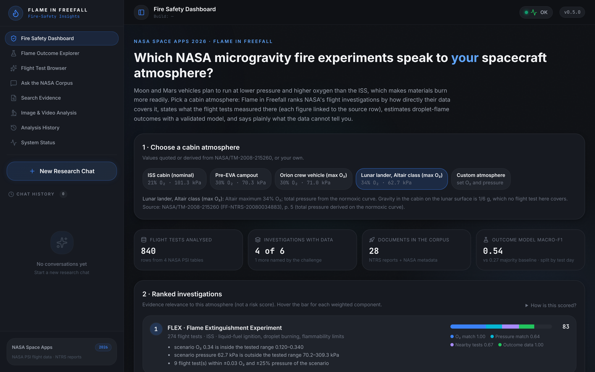
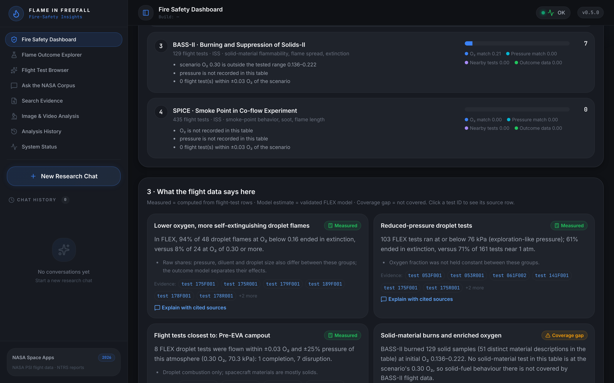
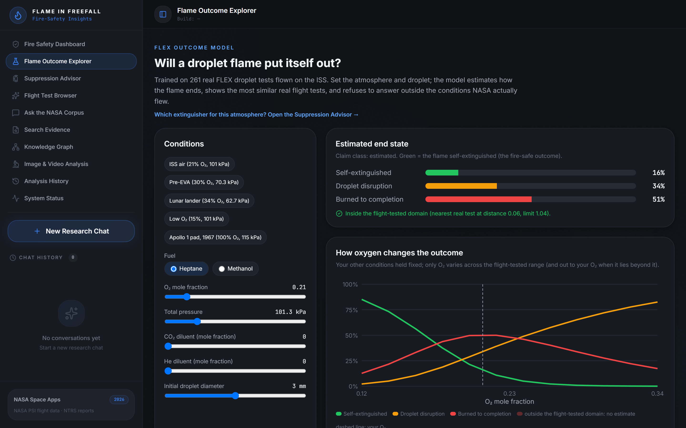

# Flame in Freefall: fire-safety insights from NASA microgravity combustion data

| Owner | Status | Version | Last updated | Plan items | Code paths |
|---|---|---|---|---|---|
| Team Flame in Freefall | Current (submission, facts updated) | 1.0.3 | 2026-11-12 | T7 | `apps/web`, `apps/api`, `ai/fire_safety` |

NASA Space Apps Challenge 2026 · Challenge: *Flame in Freefall*



## 1. The problem

Fire behaves differently in a spacecraft. Without buoyancy there is no rising plume:
- flames are pushed only by ventilation;
- they can persist at lower oxygen;
- they can spread in ways ground tests do not predict.

The next vehicles also change the atmosphere itself. NASA/TM-2008-215260 (in our corpus) records that the Orion and Altair designs allow up to 30 % and 34 % oxygen at reduced total pressure, against 21 % at 14.7 psia on the ISS. More oxygen makes materials burn more readily.

NASA has flown decades of combustion experiments (BASS, FLEX, Saffire, SPICE, ACME…). Their results are spread across experiment tables, metadata files and hundreds of reports. A mission designer asking *"what do we actually know about fire in **my** cabin atmosphere?"* has nowhere to get a direct, sourced answer.

## 2. Our solution

**A fire-safety dashboard that summarizes, ranks and explains NASA's microgravity combustion results for any cabin atmosphere, and shows its sources at every step.**

1. **Choose an atmosphere.** Four are sourced from NASA (ISS nominal, pre-EVA, Orion maximum O₂, lunar lander maximum O₂), or set O₂ and pressure yourself.
2. **Rank.** Every investigation is scored by how directly its flight data covers that atmosphere. The score has four visible components: O₂ coverage, pressure coverage, nearby tests and outcome data. It is evidence relevance, never presented as risk.
3. **Summarize.** Each investigation's objective, hypothesis, approach and impact appear in NASA's own words, from the PSI ISA-Tab metadata, with a source link.
4. **Explain.** The dashboard states what the flight tests measured there; every number comes with the IDs of the NASA table cells it came from. It also states **what the data cannot tell you**.
5. **Estimate.** A validated model estimates whether a droplet flame would self-extinguish, and shows the most similar real ISS tests next to it. It **refuses** outside the conditions NASA actually flew.
6. **Ask.** A chat answers questions over 24 NASA reports and 4 investigation records. Answers may only cite retrieved evidence; without a language model, the chat shows that evidence directly.
7. **Connect.** A knowledge graph links investigations, tests, fuels, conditions and outcomes, every link citing the NASA cell it came from. Example: which fuels did the tests that ended in extinction burn? In the web app's Knowledge Graph page, through the API, and as two AURA agent tools.



## 3. What makes it creative

- **The question is the atmosphere, not the experiment.** We turn decades of experiment records into an answer to the designer's actual question: which flight data covers *this* cabin, and what did it show?
- **Honesty is a feature.** Coverage-gap cards are first-class results. Example: *"No solid-material test in BASS-II is at 34 % O₂"*. So is the model's refusal to answer for the lunar-lander pressure. Absence of data is never shown as absence of risk.
- **Every claim is one click from NASA's own cell.** The dashboard ↔ evidence ↔ source table chain is enforced in code and tested.
- **The same API serves people and AI agents.** The four fire-safety operations compile into AURA agent tools (16 tools accepted by AURA's contract dry run, including two knowledge-graph reads).

## 4. Workflow

```
NASA PSI tables + ISA-Tab metadata + NTRS reports + flight video
   → ingest (cell-level evidence, OCR for broken PDFs) → PostgreSQL + pgvector
   → fire-safety analytics (canonical variables, ranking, insights, outcome model)
   → REST API (contract 0.6.0) → dashboard / outcome explorer / cited chat / AURA tools
```

## 5. AI and analytical methods

| Component | Method | Evidence of quality |
|---|---|---|
| Flame-outcome model (FLEX, 261 ISS tests, 80 test days) | Multinomial logistic regression on O₂, pressure, ppO₂, CO₂, He, droplet size, fuel; chosen over random forest and kNN by repeated grouped CV; exported to JSON, run with numpy | Macro-F1 **0.54 ± 0.02** vs 0.27 baseline; extinction ROC-AUC **0.86**; split by test day; strict applicability domain |
| Retrieval | PostgreSQL full-text + pgvector (`bge-small-en-v1.5`), fused with reciprocal rank fusion, then the top 10 reranked by a local cross-encoder | 26 corpus-grounded questions: hit@1 **0.88**, hit@5 **0.96**, MRR@10 **0.91** (fusion alone: 0.81 / 0.96 / 0.86; lexical-only 0.31) |
| Knowledge graph | Deterministic extraction from the PSI tables and ISA-Tab records into PostgreSQL; recursive traversal | 951 entities, 10,683 edges, each citing its NASA table cell; consistency checks clean |
| Grounded generation | Router across local and cloud models; output validated; citations outside the retrieved set dropped | Not evaluated in this run (no model available) |
| Computer vision | OpenCV segmentation of flame images and sampled video frames; temporal statistics with Nyquist and tracking-gap guards | Pixel measurements only; no temperature from RGB |
| Document AI | PDF text, OCR fallback, automatic detection of garbled font encodings | 35 garbled pages recovered by OCR |



## 6. Measured results

- **94 % of 48** FLEX droplet flames at O₂ below 0.16 self-extinguished, versus **8 % of 24** at O₂ of 0.30 or more. Computed from NASA's table and linked to every test row.
- For the lunar-lander atmosphere (34 % O₂, 62.7 kPa):
  - FLEX ranks first, and 9 of its flight tests were flown nearby.
  - BASS-II's solid-material tests stop at 22.2 % O₂, so they do not cover it.
  - The outcome model declines to estimate, because 62.7 kPa is below the lowest FLEX test pressure (70.2 kPa).
- Model drivers (permutation importance on held-out test days): O₂ dominates, followed by He and CO₂ diluents. The coefficients have the physically expected signs: more O₂ means fewer self-extinctions, while diluents and larger droplets mean more.

## 7. Practical impact

- **Mission and habitat designers:** see which atmospheres have flight evidence and where testing is missing, before choosing a cabin atmosphere.
- **Materials engineers:** jump from a question to the NASA reports (NASA-STD-6001 testing, MOC, flammability limits) with citations.
- **Researchers:** browse 840 flight tests cell by cell, with provenance and data-quality flags.

## 8. Limitations and future work

- **Limitations:**
  - outcomes are modelled for droplets only;
  - no partial-gravity data exists here;
  - SAME, ACME and FLEX-2 are not yet ingested;
  - the gold set and labels need expert review.
- **Next:**
  - parse BASS-II spread and extinction from flight video with the CV pipeline;
  - ingest SPICE flame lengths and SAFFIRE sensor workbooks;
  - add Saffire II–VI and ACME;
  - evaluate generated answers with a local 3B+ model;
  - use the knowledge graph in chat (Graph RAG), and extract platforms and instruments from the reports;
  - calibrate the relevance weights against expert judgement.

## Changelog
- 1.0.0 (2026-11-07): submission version.
- 1.0.1 (2026-11-12): contract 0.6.0 and AURA tool count (16) after PR #29.
- 1.0.3 (2026-11-12): the Knowledge Graph page.
- 1.0.2 (2026-11-12): reranked retrieval results and the knowledge graph (PR #29, #30).
