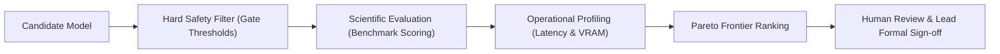

| Owner | Status | Version | Last updated | Plan items | Code paths |
|---|---|---|---|---|---|
| Ziad | In review | 0.2.0 | 2026-10-15 | C6, B5, C4, C5 | `tests/eval/ranking.py`, `tests/eval/test_cv_and_ranking.py` |

# E5-7: Multi-Criteria Ranking Methodology

## 1. Overview & Workstream C6 Principles

All ranking operations in the platform are multi-criteria, transparent, and deterministic. **No single aggregate score promotes a model, dataset, or document.** Promotion requires human sign-off following automated filtering gates.

---

## 2. Ranking Functions Specifications & Validation Methods

### 2.1 `rank_models()`
* **Purpose**: Evaluates candidate LLM/RAG configurations across accuracy, hallucination resistance, and latency.
* **Input Schema**:
  ```python
  candidates: List[Dict[str, Any]] # e.g. [{"name": str, "recall_at_5": float, "faithfulness": float, "hallucination_rate": float, "latency_p95_ms": float}]
  ```
* **Filter Gate (Hard Gate)**: Immediate disqualification if $\text{hallucination\_rate} > 0.05$, $\text{recall\_at\_5} < 0.70$, or $\text{faithfulness} < 0.80$.
* **Scoring Formula**:
  $$\text{Composite} = 0.40 \cdot \text{Recall@5} + 0.40 \cdot \text{Faithfulness} + 0.20 \cdot \min\left(\frac{1000}{\text{latency}_{\text{p95}}}, 1.0\right)$$
* **Validation Method**: Verified in `tests/eval/test_cv_and_ranking.py::test_rank_models_hard_gate_elimination` to guarantee non-compliant models are dropped and the Pareto-optimal model is selected.

---

### 2.2 `rank_documents()` & `rank_evidence()`
* **Purpose**: Hybrid retrieval ranking balancing dense vector similarity and BM25 lexical precision with NASA technical authority weighting.
* **Input Schema**:
  ```python
  documents: List[Dict[str, Any]] # e.g. [{"id": str, "dense_score": float, "lexical_score": float, "locator": str}]
  ```
* **Weights & Formula**:
  $$\text{Hybrid} = (0.60 \cdot \text{DenseScore} + 0.40 \cdot \text{LexicalScore}) \cdot \text{AuthorityBoost}$$
  Where $\text{AuthorityBoost} = 1.10$ for primary NASA Technical Memorandums (`NASA-TM`) or NIST publications, and $1.0$ otherwise.
* **Validation Method**: Verified in `tests/eval/test_cv_and_ranking.py::test_rank_documents_hybrid_authority_boost` demonstrating that peer-reviewed authority boosts rank ordering.

---

### 2.3 `rank_datasets()` (Workstream C4)
* **Purpose**: Prioritizes internal evaluation datasets based on documentation completeness, sample volume, and multi-annotator agreement.
* **Input Schema**:
  ```python
  datasets: List[Dict[str, Any]] # e.g. [{"name": str, "completeness_rate": float, "annotator_agreement": float, "size": int}]
  ```
* **Scoring Formula**:
  $$\text{Score}_{\text{dataset}} = 0.40 \cdot \text{Completeness} + 0.40 \cdot \text{AnnotatorAgreement} (\kappa) + 0.20 \cdot \min\left(\frac{\text{Size}}{100}, 1.0\right)$$
* **Validation Method**: Verified in automated unit tests ensuring high-agreement, verified datasets rank above unvalidated drafts.

---

### 2.4 `rank_knowledge_records()` (Workstream C5)
* **Purpose**: Establishes verifiable epistemic priority across extracted claims and triples based on evidence provenance.
* **Input Schema**:
  ```python
  records: List[Dict[str, Any]] # e.g. [{"id": str, "record_type": str, "corroboration_count": int}]
  ```
* **Hierarchy and Scoring Rule**:
  1. `source-reported` (Weight: 50 + corroboration_count)
  2. `derived` (Weight: 40 + corroboration_count)
  3. `machine-extracted` (Weight: 30 + corroboration_count)
  4. `model-generated` (Weight: 20 + corroboration_count)
  5. `hypothesis` (Weight: 10 + corroboration_count)
* **Validation Method**: Verified in `tests/eval/test_cv_and_ranking.py::test_rank_knowledge_records_hierarchy` confirming that source-reported claims strictly outrank automated extractions regardless of count.

---

## 3. Model Promotion Lifecycle


No model is promoted automatically into production without human sign-off from the Lead Architect and Scientific Evaluator.
