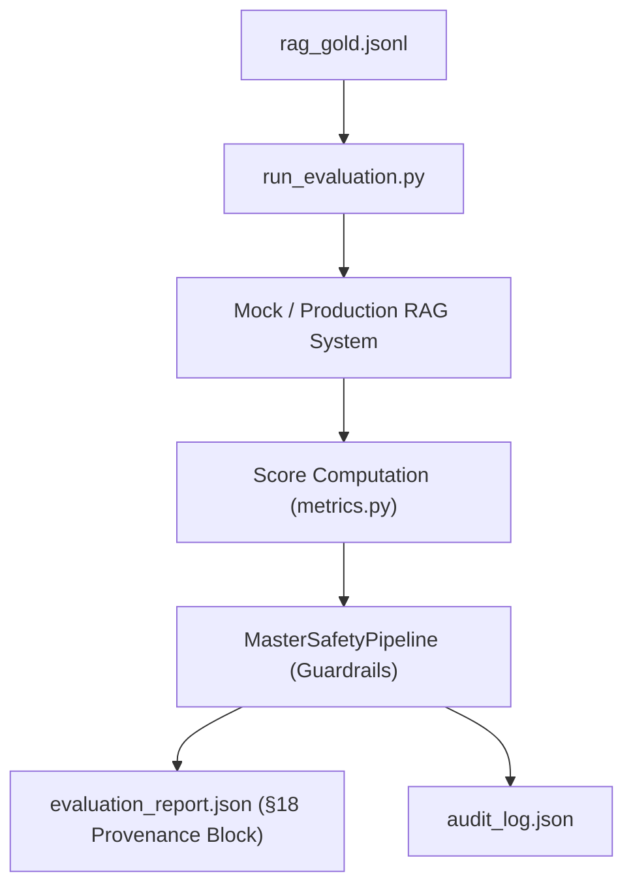

| Owner | Status | Version | Last updated | Plan items | Code paths |
|---|---|---|---|---|---|
| Ziad | In review | 0.1.0 | 2026-10-12 | M11 | `run_evaluation.py`, `tests/eval/master_pipeline.py` |

# E5-4: Harness User Guide

## 1. Quick Start & Prerequisites

Install test dependencies:
```bash
pip install -r requirements.txt
```

Run test gates:
```bash
# Automated CI test suite
pytest tests/eval/ -v

# Provenance and dataset validation
pytest tests/eval/test_provenance.py -v

# RAG & safety metric gates
pytest tests/eval/test_rag_metrics.py -v
```

---

## 2. Running the Complete Evaluation Harness

Execute the standalone CLI runner to generate an end-to-end evaluation report:
```bash
python run_evaluation.py --data datasets/evaluation/rag_gold.jsonl --out evaluation_report.json
```

### CLI Arguments
* `--data <path>`: Path to gold benchmark dataset in JSONL format (default: `datasets/evaluation/rag_gold.jsonl`).
* `--out <path>`: Destination path for formatted JSON evaluation report (default: `evaluation_report.json`).

---

## 3. Harness Architecture & Execution Flow



---

## 4. Run Metadata & Provenance Schema (§18)

Every execution produces an uneditable run metadata block:
```json
{
  "provenance": {
    "git_commit": "e.g., f9ee52f",
    "dataset_sha256": "37f48b...",
    "timestamp": "2026-10-12T23:39:10Z",
    "scorer_version": "v2.0",
    "model_provider": "gemini-pro",
    "prompt_version": "prompt-v2.0",
    "hardware": "Windows-AMD64-...",
    "rubric_version": "v2.0"
  }
}
```

---

## 5. Detecting Regressions Between Runs

To verify candidate models against the release baseline:
1. Candidate run must match or exceed baseline metrics ($\Delta \text{Recall@5} \ge -0.02$, $\Delta \text{MRR} \ge -0.02$).
2. Critical scientific safety failures (hallucination on holdout adversarial cases) trigger an immediate exit code 1.
