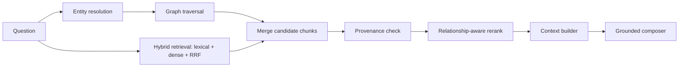

# Graph RAG design (E1-8)

| Owner | Status | Version | Last updated | Plan items | Code paths |
|---|---|---|---|---|---|
| Eman | Draft (design only; every behaviour is **Planned**) | 0.1.0 | 2026-10-14 | D4 | none yet (Planned: `ai/rag/graph/`) |

**Status: design only.** Graph RAG depends on D2 and D3 (graph schema and storage) and on M8 (entity and relation tables owned by Anas, E2). None exists. Everything below is **Planned**. Examples use synthetic ids. No metric is reported because no run exists.

Graph RAG complements the conventional pipeline in `retrieval-pipeline.md`. It never replaces it and never answers without evidence chunks.

## 1. Entity resolution

1. Query entities come from the D1 extractors (`nlp-pipeline.md`).
2. Resolve each mention to a stable id (ULID or SHA-256 content address), in this order: exact experiment id, normalised alias table, then fuzzy match above a threshold.
3. **Ambiguity:** if one mention matches more than one entity, or the best two scores differ by less than a margin, do not guess. Return all candidates to the composer, which asks for clarification or answers for each candidate separately and says so.
4. An unresolved mention is dropped from the graph query but stays in the text query.

## 2. Traversal limits

| Limit | Default (Planned) | Behaviour when exceeded |
|---|---|---|
| Hops | 2 (max 3) | stop and mark the result `truncated=true` |
| Fan-out per node | 20, ordered by edge confidence then review status | drop the rest, count the drops |
| Timeout | 800 ms for the whole traversal | return what is found, flag `graph_timeout`, continue with vector results |
| Edge filter | only edges with `review_status` in (`reviewed`, `curated`) by default | candidate edges only when the caller opts in, and they are labelled `inferred` |

## 3. Merging graph and vector candidates

- A graph edge is not evidence. It points to evidence chunks (the `evidence_ids` stored on the edge). Only those chunks enter the context.
- Candidates from both sides are merged by `chunk_id`. A chunk found by both sides gets a rank-fusion boost (RRF, same `k` as the hybrid stage).
- The reranker sees chunk text plus a short relation hint (e.g. "linked to FX-0042 by USES"); the hint is context and is never cited.
- If the graph store is unavailable, retrieval continues with the hybrid result and the response says graph evidence was not used. It never falls back to an uncited answer.

## 4. Association versus causation guard

- Graph relations are typed. Only `CAUSES`-like edges that were curated and reviewed can support causal wording. Everything else (`ASSOCIATED_WITH`, `HAS_CONDITION`, co-occurrence) supports association wording only.
- The composer assigns the claim label from the edge type: observed or measured for stated values, `inferred` for a graph-derived link, `hypothesized` for any causal reading without a reviewed causal edge.
- **Confounders:** when two investigations differ in more than one condition, the answer lists every differing condition and states that the data cannot separate their effects, unless the source states a controlled comparison.

## 5. Worked example (synthetic ids)

Question: "Which conditions are associated with the difference in flame behaviour between FX-0042 and FX-0057?"

1. Entities: `FX-0042` -> `exp-01`, `FX-0057` -> `exp-02` (exact id matches).
2. Graph: `exp-01 -HAS_CONDITION-> cond-11 (0.1 atm)`, `exp-01 -USES-> fuel-3 (methane)`, `exp-02 -HAS_CONDITION-> cond-12 (0.3 atm)`, `exp-02 -USES-> fuel-3`. Each edge lists evidence chunks (`c-demo-001`, `c-demo-014`).
3. Hybrid retrieval returns `c-demo-001`, `c-demo-009`, `c-demo-014`.
4. Merge: `c-demo-001` and `c-demo-014` appear on both sides and are boosted; `c-demo-009` has no graph link.
5. Provenance: all three chunks resolve to indexed documents.
6. Compare: pressure differs (0.1 vs 0.3 atm); fuel is the same. Flame speed differs (3.2 vs 4.1 cm/s, measured, from `c-demo-001` and `c-demo-014`).
7. Confounders: the text of `c-demo-009` says the ignition energy also differed.
8. Answer: "Flame speed was measured higher at 0.3 atm (c-demo-014) than at 0.1 atm (c-demo-001). Pressure and ignition energy both differ, so these data show an association with pressure and cannot show it caused the difference." Labels: measured, measured, inferred.

## Known limitations

- No graph schema, storage or traversal exists yet (D2, D3, M8).
- Defaults in section 2 are proposals and have not been measured.
- Entity resolution thresholds need the D1 extractors and an annotated set.
- Evaluation of the graph-only, hybrid+graph and graph+rerank variants is in `retrieval-evaluation.md` and shows **Planned** until a run exists.

## Changelog

| Version | Date | Change |
|---|---|---|
| 0.1.0 | 2026-10-14 | First design draft for E1-8 (D4); all behaviour Planned. |