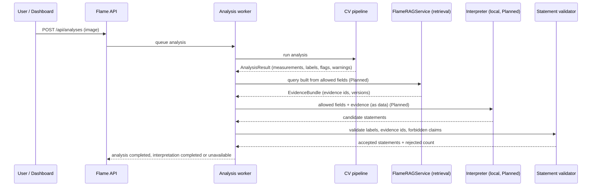

# Multimodal interpretation flow (E1-6)

| Owner | Status | Version | Last updated | Plan items | Code paths |
|---|---|---|---|---|---|
| Eman | Draft | 0.1.0 | 2026-10-14 | M13, 2H (Planned parts marked) | `cv/contracts/analysis_result.schema.json`, `apps/api/flame_api/analysis.py`, `apps/api/flame_api/aura_integration.py` (Lead), `ai/rag/` (no CV code yet) |

This document describes how a computer-vision (CV) analysis result becomes a labelled interpretation, what the code does today, and what is **Planned**. Status facts come from: the schema file `cv/contracts/analysis_result.schema.json`, one sample `cv/contracts/analysis_result.json` (schemaVersion `1.1.0`), a search of `apps/api/flame_api/*.py` on 2026-10-12, and `docs/integration/AURA_INTEGRATION_REQUIREMENTS.md`.

## 1. What exists today

| Capability | Status | Where |
|---|---|---|
| CV pipeline produces an `AnalysisResult` with labels, quality flags and warnings | Implemented (CV engineer / Lead) | schema `cv/contracts/analysis_result.schema.json` |
| API stores analyses and measurements as evidence | Implemented (Lead) | `apps/api/flame_api/analysis.py`, `models.py` |
| Interpretation through AURA, validated before storing | Implemented behind an opt-in switch (`FLAME_AURA_ENABLED`, off by default) | `apps/api/flame_api/aura_integration.py`; requirement FR-6/FR-7 in the AURA integration document |
| Statement validator: only cited evidence ids from the request, rejects statements containing the word "temperature", unsupported outcome claims and control characters | Implemented for image interpretation | `aura_integration.py` (regex checks around lines 149-151 in Eman's working tree) |
| Interpretation **without AURA** (local model or rule-based) using retrieved evidence | **Planned** (M13, 2H) | no code in `ai/` touches CV output |
| Local model that only interprets measured CV results and never overrides them | **Planned** (2H) | - |

If no interpreter is available, the analysis must still complete: the API marks `interpretation.status = "unavailable"` with the warning `INTERPRETATION_UNAVAILABLE` (AURA integration document, FR-6).

## 2. Sequence (no AURA required)



Steps marked Planned are not in code. The Lead's AURA path replaces the "Interpreter" box with a call to AURA and keeps the same validator.

## 3. Which `AnalysisResult` fields may be used

Allowed as input to an interpreter (they are measurements, labels or limits stated by the CV pipeline):

| Field group | Fields | Note |
|---|---|---|
| Identity | `analysisId`, `imageId`, `status` | `status` must be `SUCCESS` to interpret |
| Detection | `detection.status` (`PRESENT`/`ABSENT`/`UNCERTAIN`), `detection.confidence`, `detection.confidenceBasis` | confidence is `heuristic_uncalibrated` |
| Geometry | `measurements.geometry.*` (area, perimeter, centroid, aspect ratio, elongation, circularity, symmetry) | in original-image **pixels** |
| Appearance | `measurements.appearance.*` | image-derived statistics, "not physical state variables" (schema note) |
| Physical estimates | `measurements.physicalEstimates` only when not `null`, with its `classification` and `assumptions` | `null` in the sample |
| Quality | `confidenceAndQualityFlags.qualityFlags.*` (`blur`, `saturationClipping`, `lowLight`, `multipleFlames`, `occlusion`, `scaleAbsent`, `calibrationAbsent`), `qualityMetrics.*`, `detectorConfidence`, `segmenterConfidence` | must be reported with any claim they weaken |
| Labels and warnings | `scientificInterpretation.classification`, `calibrationState`, `fieldLabels`, `warnings` | the interpreter may not contradict them |
| Provenance | `provenance.pipelineVersion`, `segmenterName`, `segmenterVersion`, `inputChecksum` | for citation |

Not passed to an interpreter: local file URIs (`derivedUri`, `maskUri`, `overlayArtifactUri`, `provenance.inputUri` contain machine paths), `provenance.config` and `libraries` (internal).

## 4. Forbidden claims

| Forbidden | Reason |
|---|---|
| Temperature (or any thermal quantity) from RGB | The CV warning states it needs camera response, spectral and exposure calibration; the validator already rejects the word "temperature". |
| Physical units (mm, area in mm2) when `calibrationState = ABSENT` or `scaleAbsent = true` | Measurements are in pixels. |
| Calling the detected region a flame with certainty | Detection is a brightness heuristic (`heuristic_uncalibrated`); reflections or hardware can trigger it. |
| Fuel, chemistry, combustion regime or outcome (for example extinction) from the image alone | Not measured by the CV pipeline; the data supports condition-and-outcome questions only through evidence records (AURA integration document, finding P8). |
| Treating `saturationClipping = true` brightness values as reliable | `clippedFraction` shows how much is clipped. |
| Raising a label: an `INFERRED` field described as measured | An interpreter may never be stronger than `fieldLabels`. |
| Causal statements ("because", "caused by") from association | Project rule; use `hypothesized`. |

## 5. How every statement carries a label and evidence ids

Labels: the CV pipeline alone may produce `OBSERVED`, `MEASURED` and `ESTIMATED` (they appear in the result). An interpretation statement may only be `inferred`, `hypothesized` or `unsupported` (AURA integration document, requirement CR-3).

Proposed statement shape (**Planned** for the local path; the AURA path already validates against evidence ids and claim classes):

```json
{
  "text": "The detected region is elongated; this is consistent with an elongated luminous region, not proof of a flame.",
  "label": "inferred",
  "evidence_ids": ["EV-SYN-0001"],
  "cv_fields": ["measurements.geometry.elongation", "detection.status"]
}
```

Validation rules (the existing API validator plus the Planned additions):

1. `label` is one of `inferred`, `hypothesized`, `unsupported`.
2. Every `evidence_id` was in the evidence supplied for this analysis (existing rule: only cited ids from the request).
3. No forbidden claim from section 4 (existing: temperature, unsupported outcome, control characters).
4. Statements that fail are dropped and counted (`rejected_statement_count` per the AURA integration document); they are never stored as evidence (SR-3).

### Synthetic worked example (made-up values)

Input fields: `detection.status = PRESENT`, `geometry.elongation = 4.0`, `calibrationState = ABSENT`, `qualityFlags.saturationClipping = true`. Retrieved evidence: `EV-SYN-0001` (text about elongated luminous regions in microgravity images).

| Candidate statement | Label | Evidence ids | Result |
|---|---|---|---|
| "The region is elongated (elongation 4.0, in pixels)." | `inferred` | `EV-SYN-0001` | Accepted: pixel units, matches `fieldLabels` |
| "A region like this may indicate buoyancy-free burning." | `hypothesized` | `EV-SYN-0001` | Accepted as a hypothesis, with the clipping warning attached |
| "The flame temperature is about 1500 K." | `inferred` | `EV-SYN-0001` | **Rejected**: temperature from RGB |
| "The region is 12 mm wide." | `inferred` | `EV-SYN-0001` | **Rejected**: no scale (`calibrationState = ABSENT`) |

## 6. Known limitations

- No local (non-AURA) interpretation code exists; sections 2, 3 and 5 describe the contract it must follow.
- Only one sample result (`schemaVersion 1.1.0`) was inspected; other schema versions were not checked.
- The `cv_fields` list and the local statement shape are a proposal, not an agreed contract with the CV engineer or the Lead.
- The validator is a set of regex and id checks; it does not verify that a statement is supported by its evidence text.
- Behaviour with a local language model (it only interprets measured results and never overrides them) is **Planned** (Sub-phase 2H).

## 7. Changelog

| Version | Date | Change |
|---|---|---|
| 0.1.0 | 2026-10-14 | First version, based on the CV contract schema and the API integration code as found on branch `Eman`. |

## 8. ملخص بالعربي

نتيجة الـ CV فيها قياسات وlabels وتحذيرات. الـ interpretation مسموحله يقول `inferred` أو `hypothesized` أو `unsupported` بس، وكل جملة لازم يكون معاها evidence ids. ممنوع يقول درجة حرارة من صورة RGB ولا وحدات فيزيائية من غير calibration. الـ API عنده validator شغال (مع AURA اختياري)، لكن تفسير محلي من غير AURA لسه Planned.
