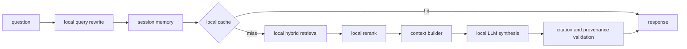

# Offline RAG behaviour (E1-11)

| Owner | Status | Version | Last updated | Plan items | Code paths |
|---|---|---|---|---|---|
| Eman | Draft | 0.1.0 | 2026-10-12 | 2H Task 5 | `ai/rag/service.py`, `ai/rag/generation/`, `ai/rag/retrieval/`, `ai/rag/reranking/`, `tests/unit/test_offline_rag.py` |

Sub-phase 2H requires Flame to keep answering when the internet, cloud models or external AI services (including AURA) are unavailable. This document says what the code does today and marks everything else **Planned**. The test file `tests/unit/test_offline_rag.py` was added in commit `34c9849` (replace with `git rev-parse --short HEAD` after committing); the other code is at `9319d65`, `0fc94c3` and `d7bf6b2` on branch `Eman`.

## 1. What is implemented and what is not

| Capability | Status | Evidence |
|---|---|---|
| The whole answer flow runs with network access blocked | Implemented, **synthetic** | `tests/unit/test_offline_rag.py::test_disconnected_run_answers_with_verifiable_evidence` replaces `socket.socket`, `create_connection` and `getaddrinfo` with functions that fail, then answers a question and checks that every citation resolves to a locally indexed chunk. Sandbox run 2026-10-12: **1 passed**; full `tests/unit` in the sandbox: 81 passed, 1 skipped, 1 failed (a missing optional library in the sandbox; Eman's machine passed all 81 at `0fc94c3` before this test was added). |
| Local lexical + vector retrieval over locally stored chunks | Implemented (in-memory) | `HybridSearchService`, `VectorSearchService`, `KeywordSearchService` |
| Local reranker | Implemented, **never run on a real model** | `CrossEncoderReranker` (tests inject a scorer) |
| Local LLM synthesis | **Planned** | Only `ExtractiveLLMProvider` exists: an offline baseline that quotes evidence; it is not an LLM |
| Graph retrieval (vector + graph) | **Planned** | Depends on D4 (Graph RAG, Week 5+) |
| Disclosure of `knowledge_version` and last-sync time | **Planned** | See section 4 |
| Cache entries that record provider and execution mode | **Planned** | See section 6 |
| Local vs cloud comparison on the same benchmark | **Planned** | No run exists; needs Ziad's harness (H-7) |
| The acceptance run in Phase 2 Plan section 7A.8 (disconnected run with a real local model, on a locally indexed NASA document) | **Not done** | The synthetic test above covers the plumbing only |

## 2. The offline flow

| Stage | Function | Status |
|---|---|---|
| Local query processing | `QueryRewriter.rewrite` | Implemented (rule-based, no network) |
| Hybrid retrieval (vector + keyword) | `RAGRetrievalPipeline.retrieve` -> `HybridSearchService.search` | Implemented; the graph part is **Planned** |
| Evidence filtering and reranking | `MetadataFilter.filter`, `Reranker` / `CrossEncoderReranker.rerank` | Implemented (passthrough by default) |
| Context building | `ContextBuilder.build` | Implemented |
| Local LLM synthesis | `LLMProvider.generate` | Interface implemented; local model provider **Planned** |
| Citation and provenance validation | `GroundedAnswerComposer.compose` | Implemented |
| Response with evidence and limitations | `FlameRAGService.answer` -> `FlameResponse` | Implemented; limitation wording for offline mode **Planned** |

Details of each stage are in `retrieval-pipeline.md` and `grounded-generation.md`.

## 3. Local-LLM adaptations

| Topic | Today | Planned (2H) |
|---|---|---|
| Context budget | `ContextBuilder` has a fixed budget (up to 5 chunks / 4000 characters) | Budget per model, derived from its context window |
| Prompt variants per local model | One prompt per id (`ai/rag/prompts/library/`) | Variants per local model, each version recording the model it was validated on (see `prompts.md`) |
| Structured-output validation | The composer parses JSON, validates every claim, label and citation; invalid JSON makes it **abstain at once** | Repair-and-retry rules (bounded number of retries, error paths only) before abstaining |

## 4. Disclosure rules

| Rule | Status |
|---|---|
| Show `knowledge_version` and last-sync time when an answer may be out of date | **Planned.** `FlameResponse.versions` carries `corpus_version`; the API's `retrieval.knowledge_version` is `null` today; there is no last-sync field. |
| Never claim the latest NASA or NIST information unless stored locally | **Planned** as wording. By design the composer can only state what retrieved local chunks contain, and abstains otherwise (`grounded-generation.md`). |
| Distinguish "external search unavailable" from "local retrieval found nothing" | **Partly.** The API returns `retrieval.searched_but_empty`. In the library, "found nothing" is `status="insufficient_evidence"` and "could not search" is `status="retrieval_unavailable"`; there is no external search, so "external search unavailable" is **Planned** wording. |

## 5. No fabricated citations, and evidence versus interpretation

- Enforced by code, not by the model: the composer removes any cited ID that is not in the retrieved set, removes claims left without a valid citation, and builds the answer text from validated claims only (`grounded-generation.md`, section 4). Tests: `test_unknown_citation_removed_and_reported`, `test_partially_supported_when_one_claim_has_no_valid_evidence`.
- This holds offline because validation uses only the locally retrieved chunks; it does not call any service.
- Evidence and interpretation stay separate: evidence goes in `<evidence>` tags, memory in `<memory>` tags, and each claim carries a label (`observed`/`measured`/`estimated`/`inferred`/`hypothesized`) and evidence IDs.

## 6. What is cached for offline reuse

- **Implemented:** final answers only, in a process-local cache (`InMemoryCacheService`). Each entry's manifest records `model` (LLM name and version), `embedding_model`, `reranker_version`, prompt versions, `corpus_version` and cited document versions (`cag-policy.md`).
- **Planned:** separate fields for provider and execution mode (local or cloud); which entries may be served when offline; retrieval-ID caching; a persistent cache that survives restarts.

## 7. Local vs cloud results

**Planned.** No benchmark run has compared local and cloud models. When Ziad's harness produces them, this section will list the run IDs, commit, benchmark version and checksum, and the numbers will be copied from the harness output, not typed.

## 8. Known limitations

- The offline test uses a fake embedder and the extractive baseline, so it proves the flow does not need the network, not that answers are scientifically good.
- No local LLM provider exists yet; no behaviour here has been measured with a real local model.
- The vector index is in memory and is rebuilt from chunks; it is not persisted.
- Graph retrieval, disclosure fields and execution-mode recording are not implemented.
- The real embedding model and the cross-encoder have not been verified offline (a first run needs the model files to be present locally).

## 9. Changelog

| Version | Date | Change |
|---|---|---|
| 0.1.0 | 2026-10-12 | First version: describes the offline flow as implemented, adds the no-network test, and marks the rest as Planned. |

## 10. ملخص بالعربي

الـ flow كله (rewrite، retrieval، rerank، composer) بيشتغل من غير أي network، وفيه test بيمنع الـ sockets ويتأكد إن كل citation بيتحل لـ chunk محلي. لكن لسه مفيش موديل LLM محلي حقيقي (عندنا baseline بيقتبس بس)، ولا graph retrieval، ولا disclosure لـ knowledge_version، ولا تسجيل لـ provider/mode في الـ cache، ولا مقارنة local vs cloud. كل ده Planned.

