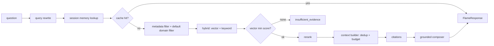

# Retrieval pipeline design (E1-1)

| Owner | Status | Version | Last updated | Plan items | Code paths |
|---|---|---|---|---|---|
| Eman | In review (ADR in section 2 is **Accepted**; ADR-006 built 2026-11-12, section 0) | 0.5.1 | 2026-11-13 | M2, M11, ADR-006, 2H (Planned parts marked) | `ai/rag/retrieval/`, `ai/rag/reranking/`, `ai/rag/query/`, `ai/rag/service.py`, `apps/api/flame_api/main.py` |

This document describes the code on branch `Eman` at commits `9319d65` (retrieval fusion/reranker/rewrite modules), `0fc94c3` (service wiring) and `d7bf6b2` (cache timing fix). Facts about `apps/api` come from a search of Eman's working tree on 2026-10-12 (`Select-String` over `apps/api/flame_api/*.py`); line numbers refer to that tree. **Planned** marks behaviour not yet in code.

## 0. The serving path since 2026-11-12 (ADR-006)

Sections 1–9 describe the code as of October and are kept as the design record. What `/api/search` and `/api/chat` run today is the **ai/rag search stack**, `ai/rag/retrieval/search_stack.py` (`flame-search-2.0.0`):

| Step | Where | What |
|---|---|---|
| Query plan | `SearchStack.plan` | `QueryRewriter` 1.0.1 (a `psi` that follows a number is a unit and is not expanded; whitespace, ISS/PSI/NTRS expansion). Lexical search uses the **original** query, because `plainto_tsquery` ANDs every term, so appended expansions could only narrow it. Semantic search embeds the **rewritten** one. Both are returned in `retrieval.query_rewrite`. |
| Candidates | `apps/api/flame_api/main.py` `search` (data access only) | PostgreSQL full-text matches (GIN-indexed `search_tsv`), the top 10 pgvector hits, and experiment-table matches. Every filter is applied in SQL: domain, `source_id`, `experiment_id`, rejected evidence. Each candidate carries its 1-based rank in each list it is in; a dense hit that is also a deep lexical match keeps its exact lexical rank. |
| Fusion | `SearchStack.fuse` | RRF, `score = Σ 1/(60 + rank)`; ties broken by result type, then ID. The dense ranking is taken over the hits that survived the filters. |
| Reranking | `SearchStack.rank` | On by default (`FLAME_RERANKER_ENABLED`): the first `FLAME_RERANK_DEPTH` (10) fused results are scored by the cross-encoder, fastembed ONNX `Xenova/ms-marco-MiniLM-L-6-v2`, reached through the router's `rerank` task (`ai/providers/local/cross_encoder.py`). Only that window is reordered. It keeps its fused score slots, so `score` stays monotonic with `rank`. The window is page-independent, so paging is exact. A reranker failure returns the fused order with `reranking.status = "unavailable"`; the search does not fail. |
| Paging | `SearchStack.page` | One ordered list, sliced. |

- **The API's inline ranking is retired.** ADR-006's condition was that `ai/rag` pass the M11 benchmark at least as well. On the 26-question gold set it returned the same top 5 as the old code for every question ([retrieval-2026-11-12.md](../evaluation/reports/retrieval-2026-11-12.md)).
- **The reranker has now run on the real model** and is **on by default**. It raised hit@1 from 0.81 to 0.88, MRR@10 from 0.86 to 0.91 and recall@5 from 0.83 to 0.88, with one regression, at about 0.7 s per search on CPU (report §Follow-up). The model is downloaded on first use; offline deployments must prepare it.
- **Chat.** `/api/chat` searches through the same stack. Its answer-cache key includes the configured reranker (`answer_cache.reranker_version`), and an answer whose retrieval had the reranker configured but unavailable is not cached.
- **What did not move.** The in-memory `RAGRetrievalPipeline` / `HybridSearchService` (weighted 0.7/0.3) and `FlameRAGService` remain library code that only `tests/unit/` uses; nothing in the API calls them. `ai/rag/retrieval/fusion.py` (list-based RRF) is kept for the same tests. Retiring or rewiring them is the library owner's (Eman's) decision, not part of ADR-006's serving change.

### 0a. Lexical OR with IDF (flag, default off) — 2026-11-13

`FLAME_LEXICAL_MODE=or_idf` (default `and`, the behaviour above) replaces the document-chunk full-text match with: every distinctive term of the question may match (`to_tsquery` with `|`), and a chunk scores the sum of the BM25 idf of the terms it contains, with `ts_rank_cd` of the OR query as a tie-break (`ai/rag/retrieval/lexical_query.py`, `apps/api/flame_api/lexical.py`). There is no term-frequency or length part: PostgreSQL full-text search does not expose them, so this is "OR with IDF", not BM25. Document frequencies are counted with the GIN index and cached for five minutes. `total_items` counts any-term matches in this mode, so it is larger. PostgreSQL only; SQLite keeps substring matching.

- **Verified:** the SQL runs on PostgreSQL 16 (`apps/api/tests/test_lexical_postgres.py`: any-term match, a rare term outranks a common one, operator characters in the question are harmless; run in CI against pgvector/pgvector:pg16).
- **Not verified:** that it retrieves better. The passage-level gold set has too few verified questions to say (the guideline needs ≥ 20), so the default stays `and`. Once the passage gold set has at least 20 verified answerable cases, decide with `python -m ai.rag.evaluation.run_passage_gold` (`run` under each setting, then `compare`: switch it on only if `difference_shown` is true for a gain), not by eye.
- **`He` (helium):** the `english` configuration drops it at index and query time, so a question about helium cannot match `search_tsv`. Migration `0012_chunk_search_tsv_keep` adds `search_tsv_keep`, a stored vector built with `flame_english` (snowball English stemming, no stopword list) and its GIN index; `or_idf` reads it automatically once it exists (`apps/api/flame_api/lexical.py`). The default `and` query keeps `search_tsv`, because with stopwords indexed `plainto_tsquery` would require "the" and "is" to match. Verified on PostgreSQL 16 (`apps/api/tests/test_lexical_postgres.py`: `He` finds the helium page only with the new vector, stemming still works, the migration is repeatable and reversible). Cost: a second tsvector and index per page. After upgrading, nothing needs re-indexing: the column is generated.

### 0b. Window-level dense index (flag, default off) — 2026-11-13

`FLAME_DENSE_GRANULARITY=window` (default `page`) makes the dense leg embed overlapping 1,200-character windows of the whole page (`ai/rag/ingestion/windows.py`, 200 overlap, cut at sentence ends) instead of the first 2,000 characters, and a page scores as its best window (`ai/rag/retrieval/aggregate.py`). Build it with `python -m flame_api.vector_index build-windows` (table `chunk_window_embedding`, migration `0011`; it re-embeds a page whose text changed and skips the rest). With no windows, or a query failure, search falls back to the page index. Fusion, the 0.55 floor and the top-10 cut are unchanged. Run `build-windows` after every ingest that changes page text, or pages without windows get no dense hit in this mode.

- **Verified:** the splitting and the aggregation (`tests/unit/test_windows.py`), and the build and search logic against a scripted session (`apps/api/tests/test_window_index.py`). The SQL mirrors `chunk_embedding`'s; the migration runs in CI on pgvector/pgvector:pg16. **Real pgvector:** `apps/api/tests/test_window_index_postgres.py` runs the real migration 0011, `build_window_index` and `search_window_chunks` with deterministic fake embeddings (a page is found by a window that is not its first; a changed page is re-embedded; a second build embeds nothing; deleting a page cascades). It is skipped without pgvector, so it runs only in CI's `pgvector/pgvector:pg16` job, not in the development environment. Real model embeddings are not exercised there.
- **Not supported by the evidence we have.** The audit's diagnostic on the 24 committed NTRS PDFs and the 26-question document-level gold found no loss from the 2,000-character cut: dense on 800-character windows scored MRR 0.78 against 0.85 for capped pages, with overlapping 95 % intervals (`.internal/research/2026-11-13-nlp-audit.md`, finding on `fastembed_embeddings.py:84`). Whether windows help *passage*-level retrieval needs the passage gold set, which has no verified questions yet (`datasets/evaluation/passage_gold_v1.jsonl` is empty). Hence the default stays `page`.
- **Cost:** on the 240 indexable pages of the 24 committed NTRS PDFs the split gives 812 windows (mean 3.4 per page, median 4, maximum 8), so about 3.4× the vectors of the page index (counted with `split_windows` over `indexed_pages`, 2026-11-13).

### 0c. Table-aware indexing — measured, **not wired into ingest** (2026-11-13)

`ai/rag/ingestion/tables.py` renders a PyMuPDF `find_tables` table as `Header=value; Header=value` rows with a strict gate (at least 3 rows, 2 columns, unique header names, 90 % of cells free of split lines). It is tested (`tests/unit/test_table_text.py`) but **ingest does not call it**, because on the corpus we have it does not help.

`python -m ai.rag.evaluation.table_probe docs/research --show 3` (24 committed NTRS PDFs, 284 pages, 2026-11-13): `find_tables` reports **41 tables on 30 pages**; **12 pass the gate, on 9 pages**. The ones that pass are not data tables: they are the preprint notice and the NASA Center for AeroSpace Information address block, which PyMuPDF reads as a grid (rendered, for example, as `This report=of changes that; of a paper=be made`). The real data tables fail the gate for a reason visible in their cells: the text layer splits decimal points onto a second line (`165` / `.` for 16.5) and merges cells. Rendering those would state wrong values as `He=165`. So the feature would add noise to 9 pages and no usable tables.

What would change this: PDFs with a clean text layer, a table extractor that works on scans (layout model or OCR-aware), or the source tables in a structured form. Enabling it then is a small change in `ingest._index_texts` (append `table_texts(page)` to the page's index text, keep the evidence excerpt verbatim, bump `PARSER_VERSION`), measured first on a passage gold set that includes table questions.

## 1. Where things stood on 2026-10-12

| Stack | What it does | Where |
|---|---|---|
| **A. `ai/rag/` library** | Chunking, embeddings, vector search (in-memory cosine), keyword search, hybrid scoring, metadata filter, reranking, context builder, citations, grounded composer, cache, memory | `ai/rag/**`; tests in `tests/unit/` |
| **B. API search** | `GET /api/search` runs **Postgres full-text** (`to_tsvector('english', ...) @@ plainto_tsquery`) with an `ilike` fallback over `document_chunk.text`, and a separate lexical query over `experiment.searchable_text`. Response says `retrieval.mode = "lexical"`, `knowledge_version = None`, `index_version = None`, and `searched_but_empty`. | `apps/api/flame_api/main.py` lines ~289-394 |

Facts about stack B:

- There is **no dense/semantic retrieval** in the API. `main.py` reports `vector_index` as `down` with the message "No vector index has been published" (lines ~157-174) and only checks that the Postgres `vector` extension exists.
- There is **no file `vector_index.py`** in `apps/api/flame_api/` on this branch (the 2026-10-10 audit mentioned one).
- The API does **not import `ai/rag`**: the API and the library share nothing today.
- Chunks are page-level rows (`DocumentChunk`, `ingest.py`): `chunk_id = "<sha256[:16]>:v1:<page>"`, with `source_id`, `page`, `section`, `evidence_id`, `text`.
- Experiment results are scored by counting query words found in `searchable_text` (line ~369); no reranking.
- The `search` endpoint returns 503 `SEARCH_UNAVAILABLE` (retryable) if the query fails (line ~384).

## 2. Consolidation decision (ADR, **Accepted** 2026-10-14)

**Status:** Accepted by Anas (Lead) on 2026-10-14: `ai/rag` is the one retrieval stack, with `FlameRAGService` behind `/api/search` and `/api/chat` and a pgvector adapter for dense search. **Done so far:** `/api/search` ranks with `reciprocal_rank_fusion` from `ai/rag/retrieval/fusion.py` (k=60; lexical list ordered by term hits, fused with the dense list; experiments use their lexical rank), semantic results are merged on every page and under an experiment filter, tests in `apps/api/tests/test_search_fusion.py`; `/api/chat` has Flame's own version-keyed answer cache (`apps/api/flame_api/answer_cache.py`). **Still Planned:** moving the lexical SQL and the router-based generation behind `FlameRAGService`, the cross-encoder reranker in the API (the response still has no reranker stage), and the pgvector adapter class. The route keeps its current behaviour until those are tested.

**Context.** Two retrieval paths exist (section 1). Stack A is richer but unused by the API. Stack B is what the dashboard and AURA call, but it is lexical only and cannot rerank, cite versions, or abstain.

**Decision.**

1. **`ai/rag/` survives** as the only place where retrieval logic lives (fusion, filters, dedup, rerank, context, citations, abstention).
2. **The Postgres `document_chunk` table remains the system of record** for chunks, `chunk_id` and `evidence_id`. Retrieval returns those IDs unchanged so citations resolve to evidence.
3. The inline lexical SQL in `main.py` becomes a **lexical adapter** behind the same interface the library uses (**Planned**). The library's in-memory `VectorSearchService` stays for tests and small offline corpora; production dense search is a pgvector adapter (**Planned**, needs an index to be published).
4. `/api/search` and `/api/chat` call one service, `FlameRAGService` (`ai/rag/service.py`), instead of building results in the route (**Planned**, owned by the Lead).
5. **Nothing is deleted yet.** After step 3 is verified, the inline FTS/`ilike` code in `main.py` is removed.

**Consequences.** One ranking path, versions recorded for every request, and abstention instead of uncited results. Cost: an ID mapping layer (library chunk dicts use `chunk_id`, `document_id`, `document_version`, `metadata.locator`; the API's `DocumentChunk` has `chunk_id`, `source_id`, `page`, `evidence_id`), and a decision on where the adapters live (`ai/` or `apps/api/`).

**Alternatives considered.** (a) Keep API-only lexical search: simple, but no semantic retrieval, no rerank, no citation validation. (b) Move everything into the API: duplicates the tested library and its 81-test suite.

**Open questions for the Lead.** Where adapters live; who owns the migration for the vector column; whether `/api/chat` is built on `FlameRAGService` directly.

## 3. Stage diagram (code as it is today)

| # | Stage | Input -> output | Class / function | Status |
|---|---|---|---|---|
| 1 | Query rewrite | `str` -> `RewrittenQuery(original, rewritten, rules_applied, rewriter_version)` | `QueryRewriter.rewrite` in `ai/rag/query/rewrite.py` | Implemented, used by `FlameRAGService` |
| 2 | Request | `RetrievalRequest(query, top_k, filters)` | `ai/rag/dto.py` | Implemented |
| 3 | Filters | chunks, filters -> filtered chunks (combustion queries get `domain=combustion` by default) | `MetadataFilter.filter`, `RAGRetrievalPipeline._apply_default_domain_filter` | Implemented (filters run **before** search) |
| 4 | Lexical + dense | filtered chunks, query, embedding -> list of `{chunk, vector_score, keyword_score, hybrid_score}` | `HybridSearchService.search` using `KeywordSearchService` and `VectorSearchService` | Implemented (weighted sum, see section 4) |
| 5 | Evidence gate | semantic results empty -> `EvidenceBundle(status="insufficient_evidence")` | `RAGRetrievalPipeline.retrieve`; `VectorSearchService(min_score=0.7)` | Implemented |
| 6 | Rerank | results -> results with `rerank_score` | `Reranker` (passthrough, default) or `CrossEncoderReranker` | Passthrough is the default; cross-encoder implemented but not the default |
| 7 | Dedup + context | results -> `{context, sources}` (max 5 chunks, 4000 characters, duplicate `chunk_id` skipped) | `ContextBuilder.build` | Implemented |
| 8 | Citations | context -> citations with `chunk_id`, `document_id`, `document_version`, `locator` | `CitationManager.attach_citations` | Implemented |
| 9 | Bundle | -> `EvidenceBundle(evidence: list[RetrievedChunk], context, citations, results, status)` | `RAGRetrievalPipeline._build_evidence_bundle` | Implemented |
| 10 | Answer | `EvidenceBundle` -> `GroundedAnswer` | `GroundedAnswerComposer.compose` (see `grounded-generation.md`) | Implemented |

The order requested by the plan (fusion, then filters, then dedup, then rerank) differs from the code in one place: filters run first. This is deliberate: a bug fixed earlier made vector search score only the filtered chunks. Post-filtering is **Planned** only if a use case needs it.

## 4. Fusion

- **Today (used by the pipeline):** weighted sum in `HybridSearchService`: `hybrid = 0.7 * vector_score + 0.3 * keyword_score / max_keyword_score` (weights are constructor parameters).
- **Implemented but not wired:** Reciprocal Rank Fusion in `ai/rag/retrieval/fusion.py`: `score(id) = sum_i w_i / (k + rank_i)`, `k = 60` by default, per-ranking weights, duplicates within one ranking counted once. `fuse_and_page(...)` fuses the **full** lists and then slices the page.
- **Page 2 and later:** the old skip of semantic results on page 2+ cannot happen in `fuse_and_page`, because slicing happens after fusion. Test: `test_page_two_still_contains_semantic_only_results`.
- **Experiment filters:** in the library, filters are applied before both retrievers, so dense and lexical results are both restricted. In the API, experiment search is lexical only (section 1), so experiment filters have no semantic path today (**Planned** with the adapter).
- The parameters (`k = 60`, weights `0.7/0.3`) are defaults and have **not** been tuned on an evaluation set.

Tests: `python -m pytest -q tests/unit/test_query_rewrite_fusion_rerank.py`; result as part of the full run `python -m pytest -q tests/unit` by Eman at `0fc94c3`: **81 passed**.

## 5. Reranker

| Item | Value |
|---|---|
| Default in `RAGRetrievalPipeline` | `Reranker`: passes `hybrid_score` through as `rerank_score` (`ai/rag/reranking/reranker.py`) |
| Real reranker | `CrossEncoderReranker` (`ai/rag/reranking/cross_encoder.py`) |
| Model name | `cross-encoder/ms-marco-MiniLM-L-6-v2` (default constructor argument) |
| Version string | `1.0.0` (our own version, recorded per request) |
| Candidate-set size | `candidate_size = 20` |
| Score logging | `last_scores` (chunk id, retrieval score, rerank score, reranker, version) and a `logger.info` line per call |
| How it is enabled | `FlameRAGService(..., reranker=CrossEncoderReranker(...))` replaces the pipeline's reranker |

Honest status: the tests use an injected scorer function, so the real model has **not** been downloaded or run in any test or evaluation, and no ranking-quality numbers exist.

## 6. Query rewrite

- Runs first in `FlameRAGService.answer`. Rules (v`1.0.0`): collapse whitespace; expand known abbreviations (default: psi, ntrs, iss) by appending the expansion in parentheses so the original token still matches lexically.
- Both queries are kept: `FlameResponse.original_query` and `FlameResponse.rewritten_query`, plus `rules_applied` inside `RewrittenQuery`. Retrieval uses the rewritten query; the composer sees the original question.
- LLM-based rewriting is **Planned**.

## 7. Versions recorded per request

`FlameRAGService.versions()` is returned in every `FlameResponse.versions`:

| Key | Example (synthetic demo) |
|---|---|
| `embedding_model` | `fake-embedder` |
| `chunker` | `SimpleChunker@1` |
| `reranker` | `cross-encoder/ms-marco-MiniLM-L-6-v2@1.0.0` or `passthrough@1` |
| `corpus_version` | `corpus-1` |
| `prompt` | `system_scientific_qa@1.0.0+grounded_answer@1.0.0` |
| `llm` | `extractive-baseline@1.0.0` |

Not recorded yet: a retrieval-configuration version (`PipelineVersions.retrieval_config` exists in `ai/rag/versions.py` but is not filled by the service) and the API's own `knowledge_version`/`index_version`, which are `null` in the API response today.

## 8. Failure behaviour

| Failure | What happens | Test / status |
|---|---|---|
| Reranker unavailable or scoring fails | `RerankerUnavailable` is raised; `FlameRAGService` returns `status="retrieval_unavailable"`, `answer=None`, `error` set. No answer without citations is produced. | `test_reranker_down_returns_error_not_uncited_answer` |
| Any other retrieval exception | Same `retrieval_unavailable` response | covered by the same code path |
| No chunk passes the filters or the vector minimum score | `EvidenceBundle(status="insufficient_evidence")`; the composer abstains without calling the model | `test_no_matching_evidence_abstains` |
| Vector index down (pgvector adapter) | **Planned**; the API already reports `vector_index: down` in health | - |
| Database error in `/api/search` | 503 `SEARCH_UNAVAILABLE`, retryable (existing API behaviour) | in `apps/api/tests/` |

The API also returns `retrieval.searched_but_empty`, which separates "searched and found nothing" from "search unavailable". This is the distinction Sub-phase 2H requires; the library does not expose it as a field yet (**Planned**).

## 9. Known limitations

- Section 0 supersedes sections 1–2 for the serving path. The library's in-memory pipeline (sections 3–4) is not on it.
- Dense search in the library is an in-memory cosine search with a fixed minimum score (`0.7`); there is no persistent or pgvector index.
- No evaluation numbers exist: Recall@k, MRR and grounded-answer rate will come from Ziad's harness (E1-10).
- Fusion weights, RRF `k`, the vector minimum score and rerank candidate size are untuned defaults.
- The cross-encoder has run on the real model only in the 2026-11-12 benchmark (CPU); it is off by default (section 0).
- ID mapping between library chunks and API `DocumentChunk` rows is not implemented.
- Local-reranker and offline behaviour for Sub-phase 2H is **Planned** (see `offline-rag.md`).

## 10. Changelog

| Version | Date | Change |
|---|---|---|
| 0.5.1 | 2026-11-13 | §0a: stopword-free vector (migration 0012) so `He` is searchable in `or_idf`. |
| 0.5.0 | 2026-11-13 | Rewriter 1.0.1 (psi after a number); §0a lexical OR with IDF behind `FLAME_LEXICAL_MODE` (default off); §0b window-level dense index behind `FLAME_DENSE_GRANULARITY` (default off); §0c table-aware indexing measured, not wired. |
| 0.4.1 | 2026-11-12 | Reranker on by default, fastembed ONNX, depth 10. |
| 0.4.0 | 2026-11-12 | Section 0: ADR-006 built: one search stack in `ai/rag` (rewrite, RRF, reranker through the router, paging), the API's inline ranking retired after the benchmark gate. |
| 0.3.0 | 2026-10-14 | `/api/search` now fuses lexical and dense rankings with RRF. |
| 0.2.0 | 2026-10-14 | ADR accepted by the Lead; recorded what is wired into the API and what is still Planned. |
| 0.1.0 | 2026-10-12 | First version. Documents both stacks, proposes the consolidation ADR, and describes the stages, fusion, reranker, rewrite, versions and failure behaviour as implemented at `0fc94c3`/`d7bf6b2`. |

## 11. ملخص بالعربي

عندنا stack تاني بيعمل search في الـ API (Postgres full-text بس، من غير semantic ولا rerank)، وstack بتاعنا في `ai/rag` اللي أغنى بس الـ API مش بيستخدمه. الاقتراح (ADR، لسه محتاج موافقة الـ Lead): `ai/rag` هو المكان الوحيد للـ retrieval logic، وجدول `document_chunk` يفضل هو المصدر للـ chunk_id والـ evidence_id، وبعدين الـ API ينده على `FlameRAGService`. المستند بيوضّح كل مرحلة والإصدارات المسجّلة وسلوك الفشل (من غير ما يرجّع إجابة من غير citations). مفيش أرقام تقييم لسه، والـ cross-encoder عمره ما اتشغّل على موديل حقيقي.

**تحديث 2026-11-12 (القسم 0):** الـ API بقى بيستخدم search stack واحد في `ai/rag` (rewrite و RRF و rerank اختياري عن طريق الـ router). اتقاس على الـ benchmark وطلع نفس نتيجة الكود القديم بالظبط، والـ cross-encoder اتشغّل على الموديل الحقيقي وحسّن hit@1 من 0.81 لـ 0.88، وبقى شغّال افتراضيًا (fastembed ONNX، أول 10 نتائج)، وبيزوّد حوالي 0.7 ثانية لكل search.
