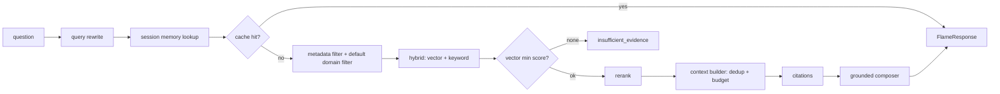

# Retrieval pipeline design (E1-1)

| Owner | Status | Version | Last updated | Plan items | Code paths |
|---|---|---|---|---|---|
| Eman | Draft (ADR in section 2 is **Proposed**, awaiting the Lead) | 0.1.0 | 2026-10-12 | M2, 2H (Planned parts marked) | `ai/rag/retrieval/`, `ai/rag/reranking/`, `ai/rag/query/`, `ai/rag/service.py`, `apps/api/flame_api/main.py` |

This document describes the code on branch `Eman` at commits `9319d65` (retrieval fusion/reranker/rewrite modules), `0fc94c3` (service wiring) and `d7bf6b2` (cache timing fix). Facts about `apps/api` come from a search of Eman's working tree on 2026-10-12 (`Select-String` over `apps/api/flame_api/*.py`); line numbers refer to that tree. **Planned** marks behaviour not yet in code.

## 1. Where things stand today

| Stack | What it does | Where |
|---|---|---|
| **A. `ai/rag/` library** | Chunking, embeddings, vector search (in-memory cosine), keyword search, hybrid scoring, metadata filter, reranking, context builder, citations, grounded composer, cache, memory | `ai/rag/**`; tests in `tests/unit/` |
| **B. API search** | `GET /api/search` runs **Postgres full-text** (`to_tsvector('english', ...) @@ plainto_tsquery`) with an `ilike` fallback over `document_chunk.text`, and a separate lexical query over `experiment.searchable_text`. Response says `retrieval.mode = "lexical"`, `knowledge_version = None`, `index_version = None`, and `searched_but_empty`. | `apps/api/flame_api/main.py` lines ~289-394 |

Facts about stack B:

- There is **no dense/semantic retrieval** in the API. `main.py` reports `vector_index` as `down` with the message "No vector index has been published" (lines ~157-174) and only checks that the Postgres `vector` extension exists.
- There is **no file `vector_index.py`** in `apps/api/flame_api/` on this branch (the 2026-10-10 audit mentioned one).
- The API does **not import `ai/rag`**: the API and the library share nothing today.
- Chunks are page-level rows (`DocumentChunk`, `ingest.py`): `chunk_id = "<sha256[:16]>:v1:<page>"`, with `source_id`, `page`, `section`, `evidence_id`, `text`.
- Experiment results are scored by counting query words found in `searchable_text` (line ~369); no reranking.
- The `search` endpoint returns 503 `SEARCH_UNAVAILABLE` (retryable) if the query fails (line ~384).

## 2. Consolidation decision (ADR, **Proposed**)

**Status:** Proposed by Eman on 2026-10-12. Needs agreement from the Lead (Anas). Ask the Lead where ADR files live; this text can be moved there unchanged.

**Context.** Two retrieval paths exist (section 1). Stack A is richer but unused by the API. Stack B is what the dashboard and AURA call, but it is lexical only and cannot rerank, cite versions, or abstain.

**Decision.**

1. **`ai/rag/` survives** as the only place where retrieval logic lives (fusion, filters, dedup, rerank, context, citations, abstention).
2. **The Postgres `document_chunk` table remains the system of record** for chunks, `chunk_id` and `evidence_id`. Retrieval returns those IDs unchanged so citations resolve to evidence.
3. The inline lexical SQL in `main.py` becomes a **lexical adapter** behind the same interface the library uses (**Planned**). The library's in-memory `VectorSearchService` stays for tests and small offline corpora; production dense search is a pgvector adapter (**Planned**, needs an index to be published).
4. `/api/search` and `/api/chat` call one service, `FlameRAGService` (`ai/rag/service.py`), instead of building results in the route (**Planned**, owned by the Lead).
5. **Nothing is deleted yet.** After step 3 is verified, the inline FTS/`ilike` code in `main.py` is removed.

**Consequences.** One ranking path, versions recorded for every request, and abstention instead of uncited results. Cost: an ID mapping layer (library chunk dicts use `chunk_id`, `document_id`, `document_version`, `metadata.locator`; the API's `DocumentChunk` has `chunk_id`, `source_id`, `page`, `evidence_id`), and a decision on where the adapters live (`ai/` or `apps/api/`).

**Alternatives considered.** (a) Keep API-only lexical search: simple, but no semantic retrieval, no rerank, no citation validation. (b) Move everything into the API: duplicates the tested library and its 81-test suite.

**Open questions for the Lead.** Where adapters live; who owns the migration for the vector column; whether `/api/chat` is built on `FlameRAGService` directly.

## 3. Stage diagram (code as it is today)

| # | Stage | Input -> output | Class / function | Status |
|---|---|---|---|---|
| 1 | Query rewrite | `str` -> `RewrittenQuery(original, rewritten, rules_applied, rewriter_version)` | `QueryRewriter.rewrite` in `ai/rag/query/rewrite.py` | Implemented, used by `FlameRAGService` |
| 2 | Request | `RetrievalRequest(query, top_k, filters)` | `ai/rag/dto.py` | Implemented |
| 3 | Filters | chunks, filters -> filtered chunks (combustion queries get `domain=combustion` by default) | `MetadataFilter.filter`, `RAGRetrievalPipeline._apply_default_domain_filter` | Implemented (filters run **before** search) |
| 4 | Lexical + dense | filtered chunks, query, embedding -> list of `{chunk, vector_score, keyword_score, hybrid_score}` | `HybridSearchService.search` using `KeywordSearchService` and `VectorSearchService` | Implemented (weighted sum, see section 4) |
| 5 | Evidence gate | semantic results empty -> `EvidenceBundle(status="insufficient_evidence")` | `RAGRetrievalPipeline.retrieve`; `VectorSearchService(min_score=0.7)` | Implemented |
| 6 | Rerank | results -> results with `rerank_score` | `Reranker` (passthrough, default) or `CrossEncoderReranker` | Passthrough is the default; cross-encoder implemented but not the default |
| 7 | Dedup + context | results -> `{context, sources}` (max 5 chunks, 4000 characters, duplicate `chunk_id` skipped) | `ContextBuilder.build` | Implemented |
| 8 | Citations | context -> citations with `chunk_id`, `document_id`, `document_version`, `locator` | `CitationManager.attach_citations` | Implemented |
| 9 | Bundle | -> `EvidenceBundle(evidence: list[RetrievedChunk], context, citations, results, status)` | `RAGRetrievalPipeline._build_evidence_bundle` | Implemented |
| 10 | Answer | `EvidenceBundle` -> `GroundedAnswer` | `GroundedAnswerComposer.compose` (see `grounded-generation.md`) | Implemented |

The order requested by the plan (fusion, then filters, then dedup, then rerank) differs from the code in one place: filters run first. This is deliberate: a bug fixed earlier made vector search score only the filtered chunks. Post-filtering is **Planned** only if a use case needs it.

## 4. Fusion

- **Today (used by the pipeline):** weighted sum in `HybridSearchService`: `hybrid = 0.7 * vector_score + 0.3 * keyword_score / max_keyword_score` (weights are constructor parameters).
- **Implemented but not wired:** Reciprocal Rank Fusion in `ai/rag/retrieval/fusion.py`: `score(id) = sum_i w_i / (k + rank_i)`, `k = 60` by default, per-ranking weights, duplicates within one ranking counted once. `fuse_and_page(...)` fuses the **full** lists and then slices the page.
- **Page 2 and later:** the old skip of semantic results on page 2+ cannot happen in `fuse_and_page`, because slicing happens after fusion. Test: `test_page_two_still_contains_semantic_only_results`.
- **Experiment filters:** in the library, filters are applied before both retrievers, so dense and lexical results are both restricted. In the API, experiment search is lexical only (section 1), so experiment filters have no semantic path today (**Planned** with the adapter).
- The parameters (`k = 60`, weights `0.7/0.3`) are defaults and have **not** been tuned on an evaluation set.

Tests: `python -m pytest -q tests/unit/test_query_rewrite_fusion_rerank.py`; result as part of the full run `python -m pytest -q tests/unit` by Eman at `0fc94c3`: **81 passed**.

## 5. Reranker

| Item | Value |
|---|---|
| Default in `RAGRetrievalPipeline` | `Reranker`: passes `hybrid_score` through as `rerank_score` (`ai/rag/reranking/reranker.py`) |
| Real reranker | `CrossEncoderReranker` (`ai/rag/reranking/cross_encoder.py`) |
| Model name | `cross-encoder/ms-marco-MiniLM-L-6-v2` (default constructor argument) |
| Version string | `1.0.0` (our own version, recorded per request) |
| Candidate-set size | `candidate_size = 20` |
| Score logging | `last_scores` (chunk id, retrieval score, rerank score, reranker, version) and a `logger.info` line per call |
| How it is enabled | `FlameRAGService(..., reranker=CrossEncoderReranker(...))` replaces the pipeline's reranker |

Honest status: the tests use an injected scorer function, so the real model has **not** been downloaded or run in any test or evaluation, and no ranking-quality numbers exist.

## 6. Query rewrite

- Runs first in `FlameRAGService.answer`. Rules (v`1.0.0`): collapse whitespace; expand known abbreviations (default: psi, ntrs, iss) by appending the expansion in parentheses so the original token still matches lexically.
- Both queries are kept: `FlameResponse.original_query` and `FlameResponse.rewritten_query`, plus `rules_applied` inside `RewrittenQuery`. Retrieval uses the rewritten query; the composer sees the original question.
- LLM-based rewriting is **Planned**.

## 7. Versions recorded per request

`FlameRAGService.versions()` is returned in every `FlameResponse.versions`:

| Key | Example (synthetic demo) |
|---|---|
| `embedding_model` | `fake-embedder` |
| `chunker` | `SimpleChunker@1` |
| `reranker` | `cross-encoder/ms-marco-MiniLM-L-6-v2@1.0.0` or `passthrough@1` |
| `corpus_version` | `corpus-1` |
| `prompt` | `system_scientific_qa@1.0.0+grounded_answer@1.0.0` |
| `llm` | `extractive-baseline@1.0.0` |

Not recorded yet: a retrieval-configuration version (`PipelineVersions.retrieval_config` exists in `ai/rag/versions.py` but is not filled by the service) and the API's own `knowledge_version`/`index_version`, which are `null` in the API response today.

## 8. Failure behaviour

| Failure | What happens | Test / status |
|---|---|---|
| Reranker unavailable or scoring fails | `RerankerUnavailable` is raised; `FlameRAGService` returns `status="retrieval_unavailable"`, `answer=None`, `error` set. No answer without citations is produced. | `test_reranker_down_returns_error_not_uncited_answer` |
| Any other retrieval exception | Same `retrieval_unavailable` response | covered by the same code path |
| No chunk passes the filters or the vector minimum score | `EvidenceBundle(status="insufficient_evidence")`; the composer abstains without calling the model | `test_no_matching_evidence_abstains` |
| Vector index down (pgvector adapter) | **Planned**; the API already reports `vector_index: down` in health | - |
| Database error in `/api/search` | 503 `SEARCH_UNAVAILABLE`, retryable (existing API behaviour) | in `apps/api/tests/` |

The API also returns `retrieval.searched_but_empty`, which separates "searched and found nothing" from "search unavailable". This is the distinction Sub-phase 2H requires; the library does not expose it as a field yet (**Planned**).

## 9. Known limitations

- The API does not use this pipeline yet; the ADR above is a proposal.
- Dense search in the library is an in-memory cosine search with a fixed minimum score (`0.7`); there is no persistent or pgvector index.
- No evaluation numbers exist: Recall@k, MRR and grounded-answer rate will come from Ziad's harness (E1-10).
- Fusion weights, RRF `k`, the vector minimum score and rerank candidate size are untuned defaults.
- The cross-encoder has never been run on a real model in this repository.
- ID mapping between library chunks and API `DocumentChunk` rows is not implemented.
- Local-reranker and offline behaviour for Sub-phase 2H is **Planned** (see `offline-rag.md`).

## 10. Changelog

| Version | Date | Change |
|---|---|---|
| 0.1.0 | 2026-10-12 | First version. Documents both stacks, proposes the consolidation ADR, and describes the stages, fusion, reranker, rewrite, versions and failure behaviour as implemented at `0fc94c3`/`d7bf6b2`. |

## 11. ملخص بالعربي

عندنا stack تاني بيعمل search في الـ API (Postgres full-text بس، من غير semantic ولا rerank)، وstack بتاعنا في `ai/rag` اللي أغنى بس الـ API مش بيستخدمه. الاقتراح (ADR، لسه محتاج موافقة الـ Lead): `ai/rag` هو المكان الوحيد للـ retrieval logic، وجدول `document_chunk` يفضل هو المصدر للـ chunk_id والـ evidence_id، وبعدين الـ API ينده على `FlameRAGService`. المستند بيوضّح كل مرحلة والإصدارات المسجّلة وسلوك الفشل (من غير ما يرجّع إجابة من غير citations). مفيش أرقام تقييم لسه، والـ cross-encoder عمره ما اتشغّل على موديل حقيقي.
