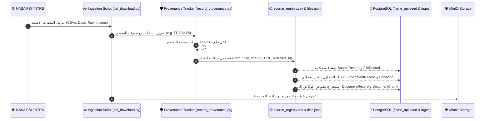
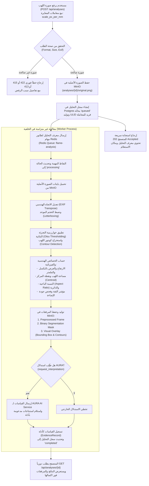
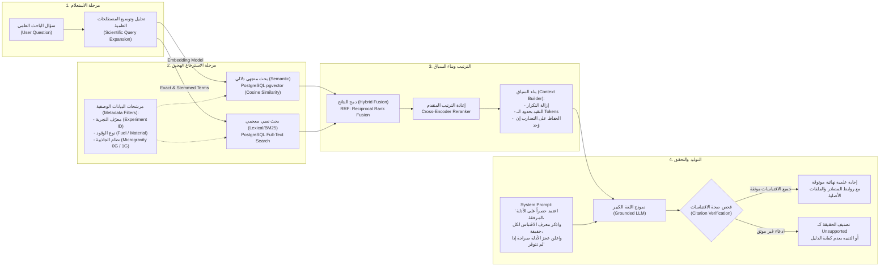
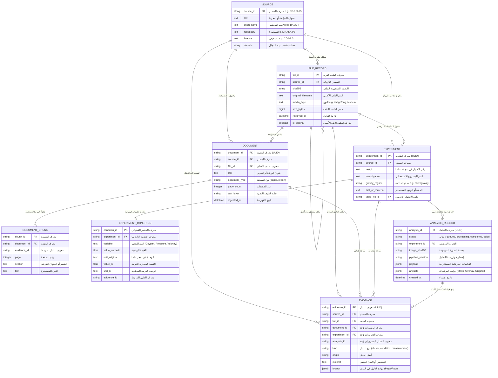
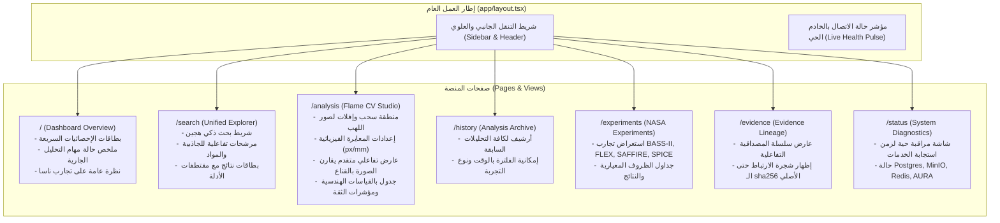
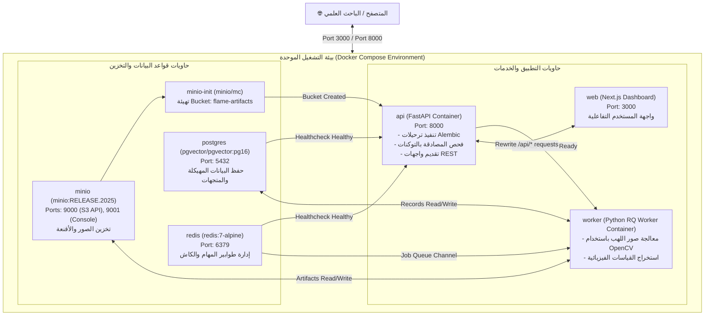

# دليل المعمارية الشامل والمخططات التوضيحية لمشروع Flame in Freefall
## Comprehensive Architecture Guide & System Diagrams

---

## 1. نبذة عامة وأهداف المشروع (Project Mission & Overview)

مشروع **Flame in Freefall** هو منصة ذكاء علمي وتحليلي مبنية وفق نهج **"الأدلة أولاً" (Evidence-First Scientific Intelligence Platform)**، تم تطويرها خصيصاً لمسابقة **NASA Space Apps Challenge**.

### 1.1 المشكلة العلمية (Scientific Context)
في بيئة الأرض (1G)، يتحكم الحمل الحراري الطبيعي (Buoyancy / Natural Convection) في شكل اللهب وسلوكه؛ حيث يصعد الهواء الساخن للأعلى مما يمنح اللهب شكله المخروطي المستدق المميز ويسحب الأكسجين باستمرار لقاعدة اللهب.  
أما في الفضاء والجاذبية الصغرى (**Microgravity - 0G/μG**)، يختفي الحمل الحراري الطبيعي تماماً، ويصبح انتقال الحرارة والغازات محكوماً بـ **الانتشار الجزيئي (Molecular Diffusion)**، مما يجعل اللهب يتخذ شكلاً كروياً (Spherical Flame)، ويحترق بدرجات حرارة وسرعات مختلفة وظواهر إخماد فريدة (Cool Flames & Radiative Extinction).

### 1.2 الركائز الأساسية للمشروع (Core Architectural Principles)
1. **الدليل فوق الادعاء (Evidence Over Claims):** لا يتم قبول أي حقيقة أو استنتاج علمي دون ربطه بسجل تجريبي موثق.
2. **سلسلة المصداقية الإلزامية (Mandatory Provenance Chain):** كل استعلام، قياس بالرؤية الحاسوبية، أو استنتاج ذكي يجب أن يتتبع مساره بدقة حتى الملف المصدر الأصلي المشفر بـ `sha256`.
3. **الحفاظ على عدم اليقين (Preserve Uncertainty):** إذا كانت البيانات غير كافية أو متضاربة، يتم إظهار التضارب صراحة للمستخدم بدلاً من افتراض إجابة وهمية (No Hallucinations).
4. **التعاقد أولاً (Contract-First Architecture):** الاعتماد على مواصفات صارمة واضحة (OpenAPI 3.1 & JSON Schemas) قبل كتابة الكود.

---

## 2. المعمارية العامة للنظام (End-to-End System Architecture)

يوضح المخطط التالي بنية المنظومة الموزعة بجميع طبقاتها: من بيانات ناسا الخام وصولاً لواجهة المستخدم ومنظومة الذكاء الاصطناعي الخارجي (AURA AI).

```mermaid
flowchart TB
    subgraph NASA_Sources["🌐 مصادر بيانات ناسا الفضائية (NASA Data Sources)"]
        PSI_API["NASA PSI API & S3<br/>(Physical Sciences Informatics)"]
        NTRS["NASA Technical Reports (PDFs)<br/>NTRS Research Papers"]
        EXP_TABLES["جداول القياسات التجريبية<br/>(CSV / ISA-Tab)"]
        RAW_MEDIA["مقاطع الفيديو والصور الفضائية<br/>(BASS-II / FLEX / SAFFIRE / SPICE)"]
        PSI_API --> RAW_MEDIA
        PSI_API --> EXP_TABLES
    end

    subgraph Data_Ingestion["📥 طبقة استيراد البيانات وتتبع المصداقية (Ingestion & Provenance)"]
        INGEST_SCRIPT["psi_download.py<br/>(تنزيل البيانات المعيارية)"]
        PROV_SCRIPT["record_provenance.py<br/>(حساب sha256 وسجل التدقيق)"]
        REGISTRY["source_registry.csv<br/>(سجل المصادر والرخص CC0)"]
        FILES_META["files.jsonl<br/>(بيانات وصفية للملفات والمصداقية)"]
        
        RAW_MEDIA --> INGEST_SCRIPT
        EXP_TABLES --> INGEST_SCRIPT
        NTRS --> PROV_SCRIPT
        INGEST_SCRIPT --> PROV_SCRIPT
        REGISTRY --> PROV_SCRIPT
        PROV_SCRIPT --> FILES_META
    end

    subgraph Storage_Tier["💾 طبقة التخزين وإدارة الحالة (Persistence & Storage)"]
        POSTGRES[("🐘 PostgreSQL 16 + pgvector<br/>- جداول المصادر والملفات<br/>- الوثائق والمقاطع (Chunks)<br/>- التجارب والظروف الفيزيائية<br/>- نتائج التحليلات وسجلات الأدلة")]
        MINIO[("🪣 MinIO Object Storage (S3-Compatible)<br/>- الصور الأصلية (Original Frames)<br/>- الصور المعالجة (Preprocessed)<br/>- أقنعة التجزئة (Binary Masks)<br/>- الرسوم المتراكبة (Overlay Visualizations)")]
        REDIS[("⚡ Redis 7 (In-Memory Data Store)<br/>- طابور المهام (RQ Job Queue)<br/>- التخزين المؤقت للاستجابات (CAG Cache)")]
    end

    FILES_META -->|flame_api.seed & ingest| POSTGRES

    subgraph Backend_Tier["⚙️ خوادم المعالجة والواجهة الخلفية (Backend & Compute)"]
        FASTAPI["🚀 FastAPI Core Service (apps/api)<br/>- إدارة واجهات OpenAPI 3.1 REST<br/>- المصادقة والتحقق (Token Auth)<br/>- البحث الدلالي والهجين<br/>- استقبال واسترجاع تحليلات الصور"]
        WORKER["👷 Background Worker (RQ Worker)<br/>- معالجة غير متزامنة لمهام الصور<br/>- تشغيل خوارزميات OpenCV<br/>- كتابة المخرجات في MinIO و Postgres"]
    end

    subgraph CV_Engine["👁️ محرك الرؤية الحاسوبية (Computer Vision Engine - cv/flame_cv.py)"]
        CV_VAL["فحص صحة الصورة وأبعادها<br/>(Image Intake & Dimensions)"]
        CV_PRE["معالجة مسبقة وتعديل التوجيه<br/>(Letterbox & EXIF Transpose)"]
        CV_SEG["تجزئة اللهب واستخلاص الحدود<br/>(Otsu Threshold & Contours)"]
        CV_FEAT["استخراج الخصائص الهندسية والفيزيائية<br/>(Height, Width, Area, Centroid, Calibration)"]
        
        CV_VAL --> CV_PRE --> CV_SEG --> CV_FEAT
    end

    subgraph AI_RAG_Engine["🧠 محرك الذكاء الاصطناعي التوليدي والبحث الدلالي (RAG & Grounding)"]
        QUERY_REWRITE["تحليل وإعادة صياغة الاستعلام<br/>(Query Analysis & Rewriting)"]
        HYBRID_RET["بحث هجين (Hybrid Retrieval)<br/>Semantic (Vectors) + Lexical (BM25)"]
        RERANKER["إعادة الترتيب الدقيق<br/>(Cross-Encoder Reranking)"]
        CTX_BUILDER["بناء وتصفية السياق<br/>(Context Builder & Token Budget)"]
        LLM_GEN["توليد الإجابات الموثقة<br/>(Grounded LLM Generation)"]
        CITE_VAL["التحقق الصارم من الاقتباسات والمصادر<br/>(Citation & Provenance Validation)"]

        QUERY_REWRITE --> HYBRID_RET --> RERANKER --> CTX_BUILDER --> LLM_GEN --> CITE_VAL
    end

    subgraph External_AI["🌐 تكامل الاستدلال المتقدم (AURA AI Integration)"]
        AURA_API["AURA Scientific Reasoning Service<br/>- تصنيف الادعاءات: Inferred / Hypothesized<br/>- استدلال أوتوماتيكي ومقارنة النتائج"]
    end

    subgraph Frontend_App["🖥️ لوحة التحكم التفاعلية (Web Dashboard - Next.js 15)"]
        UI_DASH["لوحة المؤشرات والعدّادات (Dashboard Overview)"]
        UI_SEARCH["محرك البحث الدلالي الموحد (Unified Scientific Search)"]
        UI_STUDIO["استوديو تحليل صور اللهب (Flame Analysis Studio)"]
        UI_EVIDENCE["مستكشف الأدلة وسلسلة المصداقية (Evidence & Lineage Viewer)"]
        UI_EXP["مستعرض التجارب والظروف (Experiments Explorer)"]
        UI_STATUS["مراقبة حالة النظام والخدمات (System Health & Services)"]
    end

    FASTAPI -->|Read/Write Records| POSTGRES
    FASTAPI -->|Fetch & Put Media| MINIO
    FASTAPI -->|Enqueue Jobs & Cache| REDIS

    REDIS -->|Dequeue Job| WORKER
    WORKER --> CV_Engine
    CV_Engine -->|Save Artifacts| MINIO
    CV_Engine -->|Update Status & Metrics| POSTGRES
    WORKER -.->|Optional Interpretation| AURA_API

    FASTAPI --> AI_RAG_Engine
    AI_RAG_Engine -->|Vector Search| POSTGRES

    Frontend_App <-->|REST API JSON + Multipart| FASTAPI
```



---

## 3. تجارب ناسا المعتمدة وخط أنابيب المصداقية (NASA Datasets & Provenance)

النظام مبني على أربع تجارب احتراق رئيسية من منصة ناسا للمعلوماتية الفيزيائية (**NASA Physical Sciences Informatics - PSI**) بالإضافة لتجربة مرجعية:

| المعرّف (Source ID) | اسم التجربة | المنصة الفضائية / البيئة | نوع الاحتراق والمواد | التفاصيل والملفات المتاحة |
|---|---|---|---|---|
| **FF-PSI-25** | **BASS-II** (Burning and Suppression of Solids) | محطة الفضاء الدولية (ISS MSG) | احتراق وانتشار اللهب في المواد الصلبة (Solid fuel) وإطفاؤها | 25 ملفاً، 17 فيديو احتراق، قياسات سرعة تدفق الهواء وسرعة تراجع الوقود |
| **FF-PSI-69** | **FLEX** (Flame Extinguishment Experiment) | محطة الفضاء الدولية (ISS CIR) | احتراق وإطفاء قطرات الوقود السائل (Liquid droplets) | 19 ملفاً، 274 اختبار قطرات نفاثة، درجات حرارة، أقطار القطرات وزمن الاحتراق |
| **FF-PSI-98** | **SAFFIRE-I** (Spacecraft Fire Safety) | مركبة الشحن الفضائية غير المأهولة (Cygnus) | احتراق الأقمشة على نطاق واسع في بيئة المركبة الفضائية | 9 ملفات، 1,556 إطار تصويري لتدفق الغازات واحتراق نسيج القطن والألياف |
| **FF-PSI-107** | **SPICE** (Smoke Point In Co-flow) | محطة الفضاء الدولية (ISS MSG) | دراسة نقاط تصاعد الدخان في التدفق المشترك للهب الغازي الصفائحي | 73 ملفاً بعد فك الضغط، قياسات تدفق الغاز وتركيزات السخام |
| **FF-PSI-DSI** | **DECLIC-DSI** (Directional Solidification) | محطة الفضاء الدولية (ISS) | مرجع مقارن للفيزياء الحركية غير الاحتراقية | مجموعة بيانات مرجعية لفحص اتساق بنية البيانات |

### 3.1 خط أنابيب استيراد البيانات وتتبع المصداقية (Provenance Pipeline)



---

## 4. مسار معالجة الرؤية الحاسوبية (Computer Vision Pipeline)

يعد ملف [`cv/flame_cv.py`](file:///media/belal/Data/Belal-work/Belal-NASA-project/Nasa/apps/web_nasa/Nasa/cv/flame_cv.py) النواة الرياضية والبصرية لتحليل صور اللهب. يتم تنفيذ التحليل بشكل غير متزامن بالكامل (Asynchronous) لضمان سرعة استجابة واجهة المستخدم.

### 4.1 تفاصيل تدفق التحليل (Analysis Flowchart)



### 4.2 المتغيرات الفيزيائية المستخرجة من صورة اللهب:
1. **ارتفاع اللهب (Flame Height):** المسافة الرأسية من قاعدة اللهب حتى أقصى نقطة عمودية (بالبكسل وبالملمتر عند توفر المعايرة).
2. **عرض اللهب (Flame Width):** أقصى اتساع أفقي لمنطقة الاحتراق.
3. **مساحة السطح المسقطة (Projected Area):** عدد البكسلات المضيئة الممثلة لجسم اللهب، مع تحويلها إلى $mm^2$.
4. **مركز الكتلة الضوئية (Centroid $C_x, C_y$):** نقطة المركز الهندسي المحسوبة عبر العزوم الرياضية للمساحة (Image Moments).
5. **معامل الاستدارة (Circularity / Sphericity):** قياس مدى اقتراب اللهب من الشكل الكروي التام (وهي السمة الفيزيائية الأبرز في الجاذبية الصغرى 0G نتيجة غياب تيارات الحمل).
6. **مؤشرات الجودة والثقة (Quality & Confidence Flags):** فحص التشبع اللوني (Clipping)، انخفاض التباين (Low Contrast)، وعدم دقة المقياس لتجنب الحسابات الخاطئة.

---

## 5. معمارية الذكاء الاصطناعي والاسترجاع المعزز بالأدلة (RAG & Scientific Grounding)

تضمن هذه الطبقة أن أي إجابة استفسارية أو معلومة يقدمها النظام مستندة إلى أوراق ناسا البحثية أو جداول القياسات التجريبية دون أي اجتهاد غير موثق.



### 5.1 سلسلة التحقق من المصداقية (Lineage & Provenance Chain)
تسير دورة حياة الحقيقة العلمية وفق التسلسل الصارم التالي:
$$\text{Answer Claim} \longrightarrow \text{Citation} \longrightarrow \text{Document Chunk} \longrightarrow \text{Document} \longrightarrow \text{File Record (sha256)} \longrightarrow \text{NASA Source}$$

---

## 6. مخطط الكيانات والعلاقات لقاعدة البيانات (Database ERD Diagram)

تم تصميم قاعدة البيانات في PostgreSQL لتربط بين الوثائق النصية، الملفات الرقمية، القياسات التجريبية، ونتائج تحليل الرؤية الحاسوبية بدقة متناهية:



---

## 7. مواصفات واجهة برمجة التطبيقات (API Endpoints Catalogue)

تتوافق الواجهة البرمجية في `apps/api` تماماً مع العقد المعياري الموثق في [`docs/api/openapi.json`](file:///media/belal/Data/Belal-work/Belal-NASA-project/Nasa/apps/web_nasa/Nasa/docs/api/openapi.json):

```mermaid
classDiagram
    class SystemAPI {
        +GET /api/health : فحص جاهزية وتكامل الخدمات (DB, MinIO, Redis, AURA)
        +GET /api/dashboard/counts : إحصائيات الوثائق والتجارب والتحليلات
    }

    class ResearchAPI {
        +GET /api/search : بحث موحد متعدد المعايير في الوثائق والتجارب
        +GET /api/documents/{id} : تفاصيل وثيقة معينة وسجل مصداقيتها
        +GET /api/experiments/{id} : استعراض تجربة وظروفها الفيزيائية
    }

    class EvidenceAPI {
        +GET /api/evidence/{id} : استرجاع سجل الدليل وسلسلة المصداقية الكاملة
    }

    class AnalysisAPI {
        +POST /api/analyses : رفع صورة لهب لبدء التحليل البصري (202 Accepted)
        +GET /api/analyses : استعراض سجل كافة التحليلات السابقة والترشيح
        +GET /api/analyses/{id} : استعلام تفصيلي عن حالة التحليل ونتائجه
        +GET /api/analyses/{id}/artifacts/{kind} : تحميل مرفق بصري (original, mask, overlay)
    }
```

### 7.1 جدول ملخص الـ Endpoints:

| المسار (Endpoint) | الطريقة (Method) | الدور الوظيفي | كود الاستجابة الناجحة |
|---|---|---|---|
| `/api/health` | `GET` | فحص صحة المكونات التابعة (PostgreSQL, pgvector, MinIO, Redis, AURA) | `200 OK` أو `503` |
| `/api/dashboard/counts` | `GET` | تزويد بطاقات لوحة التحكم بعدد الوثائق والتجارب والتحليلات الجارية | `200 OK` |
| `/api/search` | `GET` | بحث علمي دلالي ومعجمي مع فلاتر (نوع المستند، التجربة، المجال) | `200 OK` |
| `/api/documents/{id}` | `GET` | جلب تفاصيل وثيقة علمية مع المقاطع وسجل التنزيل الموثق | `200 OK` / `404` |
| `/api/experiments/{id}`| `GET` | جلب تفاصيل تجربة ناسا وظروف الضغط والأكسجين وسرعة التدفق | `200 OK` / `404` |
| `/api/evidence/{id}` | `GET` | محطة قراءة الدليل العلمي ورسم خط الرجوع للمصدر | `200 OK` / `404` |
| `/api/analyses` | `POST` | استلام صورة اللهب عبر `multipart/form-data` وحجز مهمة في الطابور | `202 Accepted` |
| `/api/analyses` | `GET` | استعراض سجل التحليلات مع التصفية والتقليب (Pagination) | `200 OK` |
| `/api/analyses/{id}` | `GET` | جلب القياسات المستخرجة ومعدل الثقة والروابط (Polling Endpoint) | `200 OK` |
| `/api/analyses/{id}/artifacts/{kind}` | `GET` | استعراض البايتات المباشرة للمرفقات (`original`, `preprocessed`, `mask`, `overlay`) | `200 OK` (PNG/JPEG) |

---

## 8. بنية واجهة المستخدم التفاعلية (Frontend Application Architecture)

تم بناء الواجهة الأمامية باستخدام **Next.js 15 (App Router)**، مع دعم كامل للغة TypeScript وتصميم مظلم فاخر (Aesthetic Modern Dark Theme) مستوحى من واجهات مراكز أبحاث الفضاء.



---

## 9. خريطة النشر والبنية التحتية (Infrastructure & Deployment Topology)

تعمل المنظومة محلياً وفي بيئة الإنتاج باستخدام **Docker Compose** عبر حاويات متناسقة تضمن الأمان وعزل العمليات:



---

## 10. ملخص شامل للتقنيات المستخدمة (Technology Stack Summary)

| الطبقة (Layer) | التقنيات المستخدمة (Technologies) | الوظيفة في المشروع |
|---|---|---|
| **الواجهة الأمامية (Frontend)** | Next.js 15, React 19, TypeScript, Tailwind CSS, Lucide Icons | لوحة تحكم علمية تفاعلية سريعة ومظلمة |
| **الواجهة الخلفية (Backend API)** | FastAPI, Python 3.12, Uvicorn, Pydantic, Alembic | خادم عالي الأداء يوفر واجهات OpenAPI 3.1 تعاقدية |
| **قواعد البيانات (Databases)** | PostgreSQL 16, pgvector Extension, SQLAlchemy ORM | تخزين مهيكل للبيانات التجريبية والبحث الدلالي بالمتجهات |
| **التخزين السحابي للوسائط (Object Storage)** | MinIO (AWS S3-compatible SDK: Boto3) | تخزين الصور الأصلية والأقنعة المتراكبة والصور المعالجة |
| **طوابير المهام والكاش (Queues & Cache)** | Redis 7, Python-RQ (Redis Queue) | معالجة خلفية غير متزامنة لصور اللهب وعزل أعباء العمل |
| **الرؤية الحاسوبية (Computer Vision)** | OpenCV (cv2), Pillow (PIL), NumPy | تجزئة اللهب، استخراج الخصائص الهندسية، قياس التردد والدائرية |
| **الذكاء الاصطناعي (AI / RAG / Grounding)** | RAG Pipeline, Hybrid RRF, Cross-Encoder, Grounded LLM | إجابات علمية مقيدة بالأدلة مع ربطها بالمصادر الأصلية |
| **التكامل الخارجي (External AI Integration)** | AURA AI Platform | استدلال متقدم وتصنيف موثوقية الاستنتاجات العلمية |
| **الحاويات والنشر (DevOps & Infrastructure)** | Docker, Docker Compose, Railway | بيئة تشغيل موحدة قابلة للنشر الفوري والمحاكاة المحلية |

---

> 📌 **خلاصة:** هذا الملف يمثل المرجع الشامل لكافة أجزاء المنظومة (من المصدر الفضائي في ناسا حتى بكسل الواجهة في لوحة التحكم)، وهو وثيقة حية تعكس المعمارية المنفذة فعلياً في المستودع.
