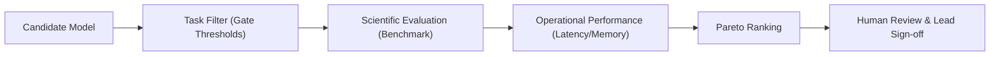

| Owner | Status | Version | Last updated | Plan items | Code paths |
|---|---|---|---|---|---|
| Ziad | In review | 0.1.0 | 2026-10-12 | C6, B5 | `docs/evaluation/ranking-methodology.md` |

# E5-7: Ranking Methodology

## 1. Overview & Workstream C6 Principles

All ranking operations in the platform are multi-criteria and transparent. **No single aggregate score promotes a model, dataset, or document.** Promotion requires human sign-off following automated filtering.

---

## 2. Ranking Functions Specifications

### 2.1 `rank_models()`
* **Inputs**: Candidate models, task performance scores (Recall@5, MRR, Faithfulness), latency (p95), cost/token.
* **Filter Gate**: Models failing any safety constraint (PII leakage $>0$, Hallucination on holdout $>0.05$) are immediately disqualified.
* **Decision Rule**: hard gates, then a weighted composite (`0.40 * recall@5 + 0.40 * faithfulness + 0.20 * speed`) as implemented in `tests/eval/ranking.py`. It is not a Pareto frontier.

### 2.2 `rank_documents()` & `rank_evidence()`
* **Inputs**: a precomputed dense similarity and a precomputed lexical score (no BM25 is implemented in this module), plus source authority rank (NASA-TM > conference paper > whitepaper).
* **Weights**: Hybrid scoring combining dense vector similarity ($0.6$) and lexical BM25 match ($0.4$).

---

## 3. Model Promotion Lifecycle

