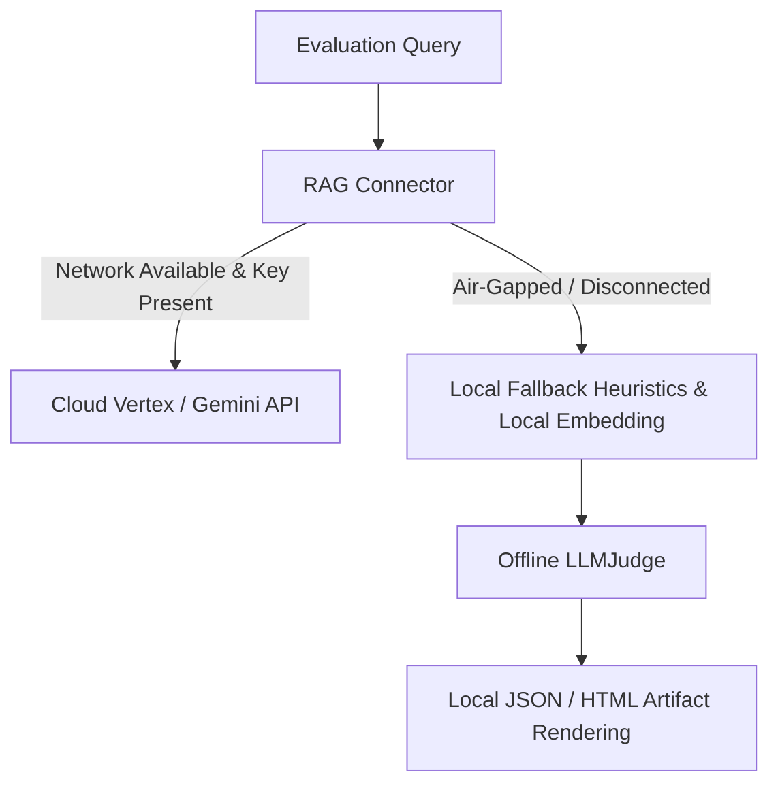

| Owner | Status | Version | Last updated | Plan items | Code paths |
|---|---|---|---|---|---|
| Ziad | In review | 0.1.0 | 2026-10-15 | C2, M11, Air-gap Deployments | `tests/eval/master_pipeline.py`, `tests/eval/test_offline_eval.py` |

# E5-11: Offline Evaluation and Air-Gapped Verification Protocol

## 1. Overview and Operational Rationale

NASA mission computing environments—including orbital test racks on the ISS, mobile field test rigs at White Sands, and air-gapped lab nodes—operate under strict physical disconnection from external public clouds. The evaluation harness must remain 100% functional, deterministic, and verifiable without internet connectivity or external API access.

---

## 2. Air-Gapped Architecture & Local Fallback Mechanisms



* **No-Network Determinism**: When `GEMINI_API_KEY` is omitted or network interfaces are down, `LLMJudge` automatically falls back to compiled local domain lexicons and regex citation verifiers without throwing unhandled network exceptions.
* **Local Storage**: All benchmarks (`rag_gold.jsonl`), schemas (`gold_schema.json`), and run logs (`audit_log.json`) reside entirely in the repository filesystem without remote database dependencies.

---

## 3. Physical Disconnection Verification Procedure

To formally verify offline execution compliance:
1. Disconnect all physical network interfaces or execute in a container with `--network none`.
2. Execute the offline pytest evaluation suite:
   ```bash
   pytest tests/eval/test_offline_eval.py -v
   ```
3. Run the standalone harness runner:
   ```bash
   python run_evaluation.py --model mock
   ```

### Verification Evidence
* Zero external socket calls established.
* Execution elapsed time: $\le 0.05\text{s}$ per instance.
* All 17 active gate tests pass with zero network warnings.
